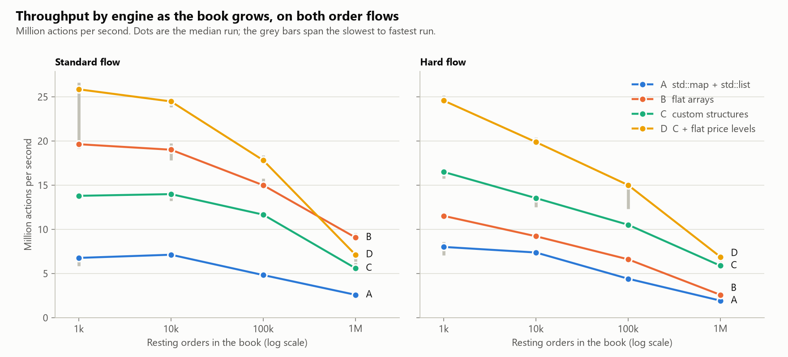
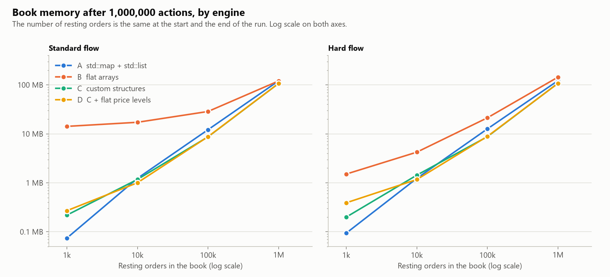
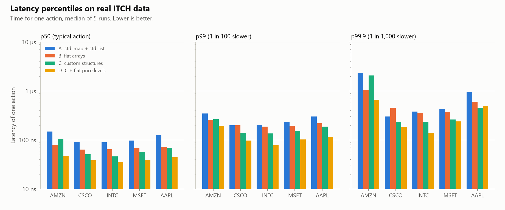

# Limit Order Book & Matching Engine

**[Read the full report (PDF)](report.pdf)**

A limit-order matching engine in C++17, implemented four times with different data structures
behind one interface, and benchmarked to answer one question:

**How does data-structure choice affect the latency and throughput of a limit-order matching engine?**

It supports limit and market orders, cancel, modify (cancel + replace), partial fills, price-time
priority, best bid/ask and spread, market depth, and a timestamped trade history. Prices are integer
cents. Python is used only to run the benchmarks, preprocess market data and draw the charts.

The engines are benchmarked on two synthetic order flows and on a real Nasdaq trading day replayed from
TotalView-ITCH 5.0 data - with the important caveat, explained in
[Real exchange data (ITCH)](#real-exchange-data-itch), that ITCH is a feed of book events the exchange
has already matched, so it tests real order-book *update* flow rather than real matching.

## The four engines

All four derive from `OrderBookBase`, pass the same tests, and produce identical trades.

| Engine | Price levels | Queue at each price | Order-id index |
|---|---|---|---|
| **A** – baseline | `std::map` | `std::list` | `std::unordered_map` |
| **B** – flat arrays | `std::vector` indexed by price | `std::vector`, cancelled slots removed in batches | `std::deque` indexed by the id (hash-map fallback for large ids) |
| **C** – custom | `std::map` (pool-allocated) | intrusive doubly-linked list in a pre-allocated node pool, 32-byte nodes | open-addressing hash map |
| **D** – C with flat levels | array indexed by price, as in B, over a window of prices with far-away levels in a small `std::map` | as C | as C |

Four intermediate versions (C1–C4) add C's changes to A one at a time, for the ablation below.

## Build and run

Requires CMake 3.15+ and a C++17 compiler.

**Windows** (tested with WinLibs MinGW-w64 GCC 16.2; `g++` and `cmake` on PATH):

```
cmake -S . -B build -G "MinGW Makefiles"
cmake --build build
.\build\tests.exe
.\build\demo.exe
```

**Linux** (GCC 9+ or Clang with a C++17 standard library that has `<memory_resource>`):

```
cmake -S . -B build
cmake --build build
./build/tests
./build/demo
```

The engines, tests and demo are standard C++17. They have only been built and run on Windows so far.
The benchmark is Windows-only (it uses the Windows API to measure memory) and CMake skips it elsewhere.

### Benchmark (Windows)

```
pip install matplotlib
python analysis\run_bench.py       # 220 runs, about 20 minutes; rewrites results\*.csv
python analysis\plot_results.py    # prints the tables, writes results\*.png
```

A single run: `.\build\bench.exe <engine> [bookSize] [actions] [run] [outDir] [standard|hard]`,
where `<engine>` is one of `A B C1 C2 C3 C4 D`.

To replay real market data instead, see [Real exchange data (ITCH)](#real-exchange-data-itch).

## Project structure

```
Order.hpp               Order, Trade, Side, OrderType
OrderBookBase.hpp/.cpp  interface for every engine + rules shared by all (validation, timestamps, trade history, modify)
OrderBook.hpp/.cpp      engine A, and C1 (A + memory pool)
FlatBook.hpp/.cpp       engine B
IntrusiveBook.hpp       engines C2, C3, C (= C4) and D: one template with pluggable index, pool and price levels
Engines.hpp/.cpp        makeBook("A" | "B" | "C1" | "C2" | "C3" | "C4" | "D")
OrderFlow.hpp/.cpp      seeded order-flow generator (standard and hard flows)
ItchReplay.hpp/.cpp     reader for the real-market action files produced from Nasdaq ITCH data
tests.cpp               40 tests per engine + a differential test + the real-data replay test
bench.cpp               benchmark executable (-O3): synthetic flows and ITCH replay
main.cpp                small demo
analysis/               run_bench.py, plot_results.py                                  (synthetic)
                        itch_download.py, itch_extract.py, run_itch.py, plot_itch.py   (real data)
results/                benchmark CSVs and charts
results_itch/           real-data CSVs and charts
results_phase3/         earlier baseline-only results
data/                   the ITCH download and the actions extracted from it (gitignored, 3.5 GB)
```

## Tests

`tests` runs the same 43 assert-based tests against each of the 7 engine variants. A differential test
then replays six seeded order flows through every engine and checks that each produces the same trades
and the same final book as engine A. Finally, if the real-market action files are present (see
[Real exchange data (ITCH)](#real-exchange-data-itch)), the same check runs on a real Nasdaq trading
day, and also asserts that no engine ever leaves the book crossed. Without that data the last test
reports that it was skipped and the rest still run.

## Benchmark method

- **Machine:** Intel Core i7-14650HX, Windows 11, GCC 16.2, `-O3 -DNDEBUG`, single thread pinned to one core.
- **Workload:** the book is filled to N resting orders (1k, 10k, 100k, 1M), then 1,000,000 generated
  actions are replayed: about 48% limit orders, 5% market orders, 37% cancels, 10% modifies. The generator
  keeps the book at N. The same seed gives the same actions for every engine.
- **Standard flow:** sequential order ids, prices within $2 of the mid (300–400 price levels in use).
- **Hard flow:** random 64-bit order ids, prices up to $50 from the mid (up to about 10,000 levels in
  use), 95% of passive orders within 20 cents of the mid.
- **Runs:** each measurement is a fresh process with 2 warm-up replays and 1 measured run; 5 runs per
  engine per size, with the engines interleaved.
- **Throughput** is timed over the whole replay. **Latency** is timed per action with the CPU cycle
  counter in a separate replay.
- **Noise rule:** two results are treated as different only if their run ranges (slowest to fastest
  run) do not overlap.

## Results

Median of 5 runs. Throughput is in million actions per second, with the slowest–fastest run in brackets.

### Throughput – standard flow

| Resting orders | A | B | C | D |
|---|---|---|---|---|
| 1k | 6.77 (5.86–6.87) | 19.64 (19.15–19.71) | 13.80 (13.79–13.92) | 25.86 (19.48–26.64) |
| 10k | 7.13 (6.99–7.34) | 19.02 (17.82–19.77) | 13.99 (13.25–14.07) | 24.49 (23.82–24.59) |
| 100k | 4.83 (4.82–4.88) | 15.00 (14.64–15.75) | 11.67 (11.46–11.93) | 17.83 (17.47–18.39) |
| 1M | 2.60 (2.59–2.70) | 9.09 (8.79–9.58) | 5.61 (5.13–6.20) | 7.14 (6.36–7.27) |

Ranking by throughput: D ~ B > C > A at 1k (their run ranges overlap); D > B > C > A at 10k and 100k;
B > D > C > A at 1M, where B's flat `std::vector` queues and sequential-id array index win out.

### Throughput – hard flow

| Resting orders | A | B | C | D |
|---|---|---|---|---|
| 1k | 8.02 (7.05–8.59) | 11.53 (11.38–11.56) | 16.50 (15.75–16.76) | 24.58 (24.39–25.15) |
| 10k | 7.38 (7.12–7.58) | 9.22 (8.82–9.41) | 13.54 (12.53–13.62) | 19.89 (19.71–20.41) |
| 100k | 4.42 (4.34–4.48) | 6.61 (6.50–6.64) | 10.52 (10.19–10.56) | 15.02 (12.34–15.24) |
| 1M | 1.94 (1.85–1.96) | 2.59 (2.48–2.63) | 5.89 (5.73–5.93) | 6.89 (6.25–6.94) |

Ranking by throughput: D > C > B > A at every size. B's lead over A falls from x2.7–x3.5 on the
standard flow to x1.25–x1.5 here, so most of it depended on sequential order ids and a narrow price
band. D gives up at most 19% of its own standard-flow throughput (at 10k; 4–5% at 1k and 1M).



### Latency per action (p50 / p99 / p99.9, nanoseconds)

Standard flow:

| Resting orders | A | B | C | D |
|---|---|---|---|---|
| 1k | 141 / 382 / 655 | 41 / 189 / 329 | 64 / 251 / 395 | 36 / 184 / 300 |
| 10k | 131 / 366 / 676 | 40 / 212 / 616 | 67 / 252 / 435 | 43 / 202 / 320 |
| 100k | 194 / 517 / 1475 | 41 / 222 / 3390 | 83 / 270 / 444 | 57 / 235 / 432 |
| 1M | 378 / 1065 / 4707 | 41 / 398 / 1054 | 172 / 491 / 731 | 129 / 468 / 727 |

Hard flow:

| Resting orders | A | B | C | D |
|---|---|---|---|---|
| 1k | 118 / 334 / 575 | 79 / 329 / 958 | 54 / 206 / 341 | 41 / 179 / 275 |
| 10k | 135 / 351 / 749 | 94 / 349 / 4661 | 65 / 255 / 503 | 45 / 208 / 317 |
| 100k | 213 / 554 / 1235 | 135 / 459 / 1336 | 84 / 314 / 460 | 64 / 250 / 432 |
| 1M | 505 / 1387 / 2755 | 371 / 1280 / 3157 | 174 / 543 / 795 | 139 / 527 / 795 |

D has the best or joint-best p99.9 at every size on both flows (727 ns against C's 731 at a 1M book on
the standard flow; 795 ns, level with C, on the hard flow). B's is the worst of the four at 100k on the
standard flow (3390 ns, over twice A's 1475) and at 10k on the hard flow (4661 ns, six times A's 749):
its lazily-removed dead slots have to be cleaned up eventually, and the clean-up all lands on one
unlucky action.

Each timing includes about 6 ns of measurement overhead.


### Ablation – standard flow

Throughput after adding each change to the one before. The bracket is the change from the previous
step; "noise" means the run ranges overlap.

| Resting orders | A | + pool | + intrusive list | + hash map | + layout (= C) | + flat levels (= D) |
|---|---|---|---|---|---|---|
| 1k | 6.77 | 8.59 (+27%) | 9.41 (+9%) | 13.47 (+43%) | 13.80 (+2%) | 25.86 (+87%) |
| 10k | 7.13 | 7.12 (noise) | 8.22 (+15%) | 13.85 (+69%) | 13.99 (noise) | 24.49 (+75%) |
| 100k | 4.83 | 4.93 (noise) | 6.34 (+29%) | 11.48 (+81%) | 11.67 (noise) | 17.83 (+53%) |
| 1M | 2.60 | 3.09 (+19%) | 3.70 (+20%) | 6.00 (+62%) | 5.61 (noise) | 7.14 (+27%) |

The memory pool — the change I expected to matter most after Phase 3 — is the step that refuses to
settle down: +27% at 1k and +19% at 1M here, within noise at 10k and 100k, and in two earlier sessions
anywhere from −10% to within noise at every size. Three sessions have not agreed on it, so the honest
conclusion is that it is worth less than the noise of my setup. The two reproducible wins are the
open-addressing hash map (+43–81% in every session) and the flat array of price levels (+27–87%); the
compact node layout is within noise except for a borderline +2% at 1k.


### Book memory

MB used by the book right after filling it → after 1,000,000 more actions (the number of resting
orders is the same at both points). Measured as process growth through the Windows API; values for
the 1k book are approximate.

| Resting orders | Flow | A | B | C | D |
|---|---|---|---|---|---|
| 1k | standard | 0.15 → 0.07 | 0.27 → 14.21 | 0.24 → 0.22 | 0.25 → 0.27 |
| 10k | standard | 1.17 → 1.23 | 0.94 → 17.22 | 0.92 → 1.17 | 0.94 → 1.00 |
| 100k | standard | 12.26 → 12.16 | 8.86 → 28.64 | 8.66 → 8.71 | 8.71 → 8.75 |
| 1M | standard | 122.29 → 121.05 | 89.51 → 120.42 | 107.19 → 107.20 | 107.23 → 107.26 |
| 1k | hard | 0.14 → 0.09 | 1.33 → 1.51 | 0.22 → 0.20 | 0.40 → 0.39 |
| 10k | hard | 1.27 → 1.23 | 2.34 → 4.23 | 1.02 → 1.43 | 1.18 → 1.17 |
| 100k | hard | 12.27 → 12.64 | 13.59 → 21.27 | 8.79 → 8.75 | 8.62 → 8.88 |
| 1M | hard | 123.16 → 122.01 | 120.63 → 144.17 | 108.24 → 108.11 | 107.45 → 107.44 |

A, C and D stay flat, as they should: the book holds the same number of orders at both points. B is
the exception, and the next section explains why. D's price window (at most 65,536 levels, 786 KB per
side) never shows up here, because both synthetic flows span few enough prices to sit inside one
window — the window only earns its keep on real data.



More output is in `results/`: the per-run CSVs, latency by action type, and latency distribution charts
at 1M orders for both flows. `python analysis\plot_results.py` reprints every table.

### Why engine B's memory spikes

B is the only engine whose memory grows while the number of resting orders stays the same
(0.27 → 14.21 MB at a 1k book on the standard flow). Both of B's "index by the number itself instead
of hashing" tricks contribute, and only one of them was intended.

**1. The order-id array (a real design cost).** `direct_` is a `std::deque<Slot>` indexed by order
id, so finding an order is one subtraction and one load instead of a hash. It therefore has to be as
long as the *largest id ever seen*, not as long as the book. The standard flow issues sequential ids,
so 1,000,000 actions use about 527,000 ids: 527,000 × 24 bytes = **12.1 MB**, whatever the book size.
That is why the growth is almost the same at 1k and at 10k. Nothing can be freed — an array indexed
by id cannot have holes punched out of it — so this is the price of the design, not a bug. (The hard
flow uses random 64-bit ids, which skip `direct_` entirely and go to the `overflow_` hash map, so it
pays nothing here.)

**2. Price levels keeping buffers they no longer need (a bug, now fixed).** Each price level is a
`std::vector<Order>`, and `tidy()` used to empty a level with `clear()`, which keeps the allocated
buffer "ready for the next orders". That is right for the handful of levels at the best price, which
empty and refill constantly, but wrong for the book as a whole: over a long run the book touches far
more prices than it ever holds orders at, and each one of those kept a buffer sized to its own peak —
including the slack of up to `kSlack` (32) dead slots per level that the lazy-deletion scheme leaves
behind. After 1M actions on the hard flow, 9,832 *empty* levels were still holding 199,383 order
slots (**7.6 MB**) for 999 live orders.

The fix is one branch in `tidy()`: when a level empties, release the buffer
(`std::vector<Order>().swap(level.orders)`) unless it is already small (≤ `kKeepSlots` = 8 slots),
which keeps the hot levels allocation-free. Slots held by empty levels at a 1k book:

| Flow | Before | After |
|---|---|---|
| standard | 41,778 slots (1.6 MB) | 4,239 slots (0.16 MB) |
| hard | 199,383 slots (7.6 MB) | 11,615 slots (0.44 MB) |

Memory after the flow, old and new binaries run back to back (3 runs each):

| Resting orders | Flow | Before | After |
|---|---|---|---|
| 1k | standard | 15.80 MB | 14.20 MB |
| 10k | standard | 18.02 MB | 17.22 MB |
| 100k | standard | 30.02 MB | 28.75 MB |
| 1M | standard | 124.1 MB | 121.6 MB |
| 1k | hard | 9.21 MB | 1.50 MB |
| 10k | hard | 8.56 MB | 4.25 MB |
| 100k | hard | 24.30 MB | 21.20 MB |
| 1M | hard | 144.1 MB | 144.2 MB |

The hard flow at 1k improves by 84%; the standard flow barely moves, because there the 12.1 MB id
array dominates and that part is inherent. At a 1M book nothing changes, because then the book really
is holding a million orders. Throughput is unchanged: in interleaved runs every comparison has
overlapping run ranges (the noise rule), the largest median gap being −8% on the standard flow at 1k,
where levels empty and refill most often. Every table above was re-measured with the fix in place.


## Real exchange data (ITCH)

The synthetic flows above are my own invention, so the obvious objection is that they flatter whichever
engine happens to suit them. This phase replays a real trading day through the same four engines:
**30 December 2019 on Nasdaq, from the free TotalView-ITCH 5.0 sample file** (3.5 GB gzipped,
266 million messages), for five liquid symbols.

### What this tests, and what it does not

**ITCH is a feed of book events Nasdaq has already matched, not the raw order flow that arrived at the
exchange.** Every message says what *happened* to the order book — an order was added, cancelled,
deleted, replaced or executed. During continuous trading an Add Order message therefore never crosses
the book: had the incoming order been executable, Nasdaq would have matched it and published execution
messages instead.

So this measures the engines on **real order-book update flow** — real order-id patterns, real price
clustering, real book sizes, a real mix of adds, cancels and executions — and **not on real matching**.
The matching path is barely touched. Nothing here says how well an engine matches.

That claim is measured, not assumed: across all 4.4 million real actions, every engine produced
**zero trades** and the book was **never crossed, not once**. See the correctness table below.

### The data

`analysis/itch_extract.py` streams the gzipped file (it is never loaded — ~8.3 GB raw) and converts one
symbol's messages into the engine's existing actions:

| ITCH message | Engine action |
|---|---|
| `A`, `F` — add order (without / with attribution) | add a limit order |
| `D` — order delete (whole order gone) | cancel |
| `X` — order cancel (part of an order gone) | modify to the smaller quantity |
| `E`, `C` — order executed (with / without price) | modify to the smaller quantity, or cancel if nothing is left |
| `U` — order replace (new price, size and id) | modify to the new price and quantity |

Measured window: **09:30–16:00**, continuous trading only. Before the opening cross the displayed book
is legitimately *crossed* — buy and sell orders for the 09:30 auction pile up with bids above asks and
the exchange holds them rather than matching them — so replaying the pre-open would have the engines
trade orders Nasdaq was still holding. The extractor still tracks the book from 04:00, so it knows
exactly what was resting at 09:30 and writes that out as a **prefill** block, which the benchmark
applies untimed before measuring, exactly as it does with the synthetic flows.

| Symbol | ITCH messages = actions | adds | cancels | modifies | 09:30 book | peak book | price span touched |
|---|---|---|---|---|---|---|---|
| AAPL | 1,477,252 | 694,517 | 668,258 | 114,477 | 828 | 27,102 | $0.01 – $199,999.00 |
| MSFT | 1,188,106 | 573,145 | 551,280 | 63,681 | 1,075 | 22,996 | $0.01 – $199,999.99 |
| INTC | 740,571 | 351,413 | 343,027 | 46,131 | 136 | 8,605 | $0.01 – $199,999.99 |
| CSCO | 529,009 | 253,867 | 240,855 | 34,287 | 259 | 13,405 | $0.01 – $199,999.99 |
| AMZN | 477,185 | 227,054 | 191,717 | 58,414 | 1,724 | 37,063 | $0.01 – $199,999.00 |

4,412,123 actions in total. One ITCH message becomes exactly one engine action, so the two counts are
the same number. Of 266 million messages in the file, only 40 carried a price that was not a whole
cent (rounded, and counted), and 29 adds had no usable price and were skipped.

Three honest caveats about the mapping:

1. The engine's `modifyOrder` is cancel + re-add, so it sends the order to the **back** of its price
   level. For `U` (replace) that is exactly right — a real replace loses time priority too. For `X` and
   `E` it is not: shrinking an order, or partially filling it, keeps its place in the real queue. The
   engines have no "reduce in place" call and this phase does not change them. The set of resting
   orders and their quantities stays correct; only the order *within* one price level differs.
2. `U` gives the order a brand-new ITCH reference number. Rather than emit a cancel and an add, the
   extractor keeps using the original id inside the engine and remembers that later messages about the
   new reference mean that same order — so one message stays one action and the book is identical.
3. `E`, `C` and `X` carry a *delta* (shares executed or cancelled), so the extractor keeps its own copy
   of each tracked order's resting quantity to turn deltas into the absolute quantity `modifyOrder` wants.

### Getting the data and running it

The data is deliberately not in git (`data/` is gitignored — it is 3.5 GB).

```
python analysis\itch_download.py     # 3.5 GB; parallel ranged requests, resumable
python analysis\itch_extract.py      # streams it, writes data\itch\<SYMBOL>.actions
python analysis\run_itch.py          # 100 runs (5 symbols x 4 engines x 5 runs)
python analysis\plot_itch.py         # prints the tables, writes results_itch\*.png
```

A single replay: `.\build\bench.exe replay <engine> <actionFile> [run] [outDir] [maxActions]`.
Measurement is identical to the synthetic benchmark — same warm-ups, same single measured run per
process, same 5 interleaved runs, same percentiles, same noise rule — so the two are directly
comparable. **Engine B needs about 1.9 GB per process on real prices** (see below); D needs about
0.5 GB.

### Correctness

`tests.exe` replays the real data through **all seven** engine variants and checks that they finish
identical — same best bid and ask, same depth at every price, same order count, same quantity on every
individual order id, same trades — and that no engine ever leaves the book crossed.

| Symbol | Actions replayed | Resting at the end | Engines agreeing | Trades from the prefill | Trades during the replay | Times crossed |
|---|---|---|---|---|---|---|
| AAPL | 1,000,000 | 22,019 | 7 / 7 | 0 | 0 | 0 |
| MSFT | 1,000,000 | 19,642 | 7 / 7 | 0 | 0 | 0 |
| INTC | 740,571 | 8,522 | 7 / 7 | 0 | 0 | 0 |
| CSCO | 529,009 | 13,271 | 7 / 7 | 0 | 0 | 0 |
| AMZN | 477,185 | 37,061 | 7 / 7 | 0 | 0 | 0 |

(The test caps a symbol at 1,000,000 actions to stay quick; the benchmark replays the whole day.)
The zeros in the last three columns are the honesty point, measured: real ITCH adds never cross.

### Results

*These numbers are the session after engine D's far-away-price fix (see "Fixing D: a price window
plus a side map"). D's pre-fix numbers, and what changed, are in that section; A, B and C are
unaffected by the fix, and the whole suite was re-run in one session so every engine here is
directly comparable.*

100 runs: 5 symbols x 4 engines x 5 runs, each a fresh process, interleaved. Median of the 5 runs,
with the slowest–fastest run in brackets. Every run finished with all four engines on an identical
book, and the book was never crossed.

| Symbol | Engine | M actions/s | [spread] | vs A | p50 ns | p99 ns | p99.9 ns | worst | book MB | after MB |
|---|---|---|---|---|---|---|---|---|---|---|
| AMZN (477k actions) | A | 6.99 | [6.91–7.04] | – | 142 | 312 | 1302 | 53 µs | 0.60 | 5.12 |
| | B | 13.18 | [12.40–13.34] | x1.89 | 79 | 262 | 688 | 226 µs | 1938 | 1942 |
| | C | 9.92 | [9.90–10.04] | x1.42 | 103 | 240 | 438 | 28 µs | 3.69 | 4.12 |
| | D | **16.51** | [16.24–16.99] | **x2.36** | 47 | 127 | 414 | 233 µs | 6.05 | 6.05 |
| CSCO (529k) | A | 11.58 | [11.43–11.71] | – | 92 | 208 | 331 | 38 µs | 0.16 | 1.93 |
| | B | 15.93 | [15.70–16.12] | x1.37 | 64 | 201 | 474 | 568 µs | 1937 | 1940 |
| | C | 19.89 | [19.69–20.14] | x1.72 | 52 | 144 | 254 | 28 µs | 1.12 | 1.23 |
| | D | **27.82** | [24.59–28.11] | **x2.40** | 39 | 101 | 169 | 81 µs | 1.36 | 1.60 |
| INTC (741k) | A | 11.44 | [10.40–11.62] | – | 92 | 211 | 322 | 50 µs | 0.11 | 1.28 |
| | B | 16.18 | [14.09–16.34] | x1.41 | 65 | 200 | 437 | 133 µs | 1939 | 1940 |
| | C | 22.33 | [20.52–22.63] | x1.95 | 46 | 140 | 260 | 32 µs | 0.92 | 1.09 |
| | D | **31.01** | [29.47–31.22] | **x2.71** | 36 | 84 | 174 | 183 µs | 1.25 | 1.79 |
| MSFT (1.19M) | A | 10.28 | [9.80–10.32] | – | 99 | 234 | 432 | 46 µs | 0.37 | 3.24 |
| | B | 15.02 | [14.89–15.06] | x1.46 | 69 | 196 | 370 | 346 µs | 1937 | 1940 |
| | C | 18.09 | [18.03–18.33] | x1.76 | 58 | 157 | 276 | 38 µs | 2.07 | 2.34 |
| | D | **27.92** | [25.58–28.36] | **x2.72** | 40 | 101 | 177 | 179 µs | 2.59 | 3.37 |
| AAPL (1.48M) | A | 8.19 | [8.13–8.36] | – | 120 | 290 | 669 | 154 µs | 0.38 | 3.87 |
| | B | 14.04 | [13.88–14.18] | x1.72 | 71 | 206 | 415 | 257 µs | 1940 | 1941 |
| | C | 14.38 | [14.27–14.56] | x1.76 | 69 | 185 | 367 | 63 µs | 2.25 | 2.82 |
| | D | **25.78** | [20.21–25.87] | **x3.15** | 44 | 105 | 189 | 79 µs | 3.36 | 3.36 |

`book MB` is one book after the 09:30 prefill, `after MB` the same book after the whole day.

Ranking by throughput, best first (`~` = within noise of its neighbour):

| Symbol | Throughput | p99 | p99.9 |
|---|---|---|---|
| AMZN | D > B > C > A | D > C > B ~ A | D ~ C ~ B ~ A |
| CSCO | D > C > B > A | D > C > B > A | D ~ C ~ A ~ B |
| INTC | D > C > B > A | D > C > B ~ A | D ~ C ~ A ~ B |
| MSFT | D > C > B > A | D > C ~ B ~ A | D > C ~ B ~ A |
| AAPL | D > C > B > A | D > C > B > A | D ~ C > B ~ A |


Four things stand out:

1. **D wins on every symbol now** — throughput x2.36–x3.15 of A, the best p50 (36–47 ns against A's
   92–142 ns) and the best p99 of the four everywhere. Indexing price levels by price is the single
   best idea in the project, and with the window fix there is no longer a symbol where it backfires.
2. **The two collapses are gone.** AMZN went from x0.67 of A to x2.36 and AAPL from x1.88 to x3.15;
   D's worst single action went from 48.7 ms to 233 µs on AMZN and from 44.9 ms to 79 µs on AAPL; and
   its memory after a full day went from 463 MB to 6.05 MB (AMZN) and 461 MB to 3.36 MB (AAPL). D now
   sits with A and C at 1.25–6.05 MB instead of with B at nearly 2 GB. The before picture is in "Why D
   used to collapse on two symbols" below, the fix in the section after it.
3. **The tail is still D's weakest column.** Its worst action, 79–233 µs, is the worst or
   second-worst of the four engines on four of the five symbols, against C's steady 28–63 µs. Nothing in that
   range shows up before the p99.9 (which D wins or ties everywhere), so it is a handful of actions
   per run; the likely cause is the window being rebuilt — allocating and filling a fresh array of up
   to 65,536 levels — but I have not confirmed that by timing individual actions.
4. **A, C and D all beat their own synthetic results on the three smaller books** (CSCO, INTC, MSFT:
   x1.14–x1.62 of their standard-flow throughput). Real flow is in one way *easier* than my synthetic
   flow: its mix is 47.6% adds, 45.2% plain cancels and 7.2% modifies, with **no market orders at
   all**, whereas the synthetic mix has 10% modifies and 5% market orders — the two most expensive
   actions in every engine. They fall behind on AMZN, the biggest book, compared against a synthetic
   book less than a third of its size. B is the one engine that is below its standard-flow result
   everywhere (x0.69–x0.85); see the note under the next table.



### Real data against the synthetic flows

Each symbol is compared with the synthetic book size closest to its peak real book size. That is
10,000 orders for all five, which is a fair match for INTC (8.6k) and CSCO (13.4k) but understates
MSFT (23.0k), AAPL (27.1k) and especially AMZN (37.1k) — those three would sit between the synthetic
10k and 100k rows, so their synthetic comparison is a little flattering.

| Symbol | Engine | real M/s | synthetic standard | synthetic hard | real vs standard | real vs hard |
|---|---|---|---|---|---|---|
| AMZN | A | 6.99 | 7.13 | 7.38 | x0.98 (noise) | x0.95 |
| | B | 13.18 | 19.02 | 9.22 | x0.69 | x1.43 |
| | C | 9.92 | 13.99 | 13.54 | x0.71 | x0.73 |
| | D | 16.51 | 24.49 | 19.89 | x0.67 | x0.83 |
| CSCO | A | 11.58 | 7.13 | 7.38 | x1.62 | x1.57 |
| | B | 15.93 | 19.02 | 9.22 | x0.84 | x1.73 |
| | C | 19.89 | 13.99 | 13.54 | x1.42 | x1.47 |
| | D | 27.82 | 24.49 | 19.89 | x1.14 (noise) | x1.40 |
| INTC | A | 11.44 | 7.13 | 7.38 | x1.60 | x1.55 |
| | B | 16.18 | 19.02 | 9.22 | x0.85 | x1.75 |
| | C | 22.33 | 13.99 | 13.54 | x1.60 | x1.65 |
| | D | 31.01 | 24.49 | 19.89 | x1.27 | x1.56 |
| MSFT | A | 10.28 | 7.13 | 7.38 | x1.44 | x1.39 |
| | B | 15.02 | 19.02 | 9.22 | x0.79 | x1.63 |
| | C | 18.09 | 13.99 | 13.54 | x1.29 | x1.34 |
| | D | 27.92 | 24.49 | 19.89 | x1.14 | x1.40 |
| AAPL | A | 8.19 | 7.13 | 7.38 | x1.15 | x1.11 |
| | B | 14.04 | 19.02 | 9.22 | x0.74 | x1.52 |
| | C | 14.38 | 13.99 | 13.54 | x1.03 | x1.06 |
| | D | 25.78 | 24.49 | 19.89 | x1.05 (noise) | x1.30 (noise) |

With D fixed, the only engine whose *ranking* real data still changes is B: real flow puts C above B on
four of the five symbols, where the synthetic standard flow at 10,000 orders puts B above C. That is
the same lesson as Phase 4 — B's standard-flow lead depended on sequential order ids feeding its array
index, and real ITCH reference numbers run into the tens of millions, so nearly all of them exceed its
4-million-entry direct array and fall back to the hash map. It shows up directly in the ratios: B is
x1.43–x1.75 of its own *hard*-flow result but only x0.69–x0.85 of its *standard*-flow result, on every
symbol. D's x0.67 on AMZN is the book-size caveat above, not a structural problem: AMZN's real book
peaks at 37,000 orders against the 10,000-order synthetic row it is compared with.


### What the $0.01 / $199,999.99 orders are

Both of the effects below are caused by a tiny number of orders at the extreme ends of the price range,
so it is worth establishing what they actually are. Across all five symbols and the whole session,
**415 adds** are priced at or below $1 or at or above $100,000 — against 2.1 million adds inside the
measured windows.

$199,999.99 is not arbitrary: it is **the highest limit price Nasdaq's system accepts**, and the `OUCH`
specification notes that an order entered above it is treated as a market order instead. So these
orders sit at the very top and bottom of the permitted range.

Scanning the raw feed for attribution (ITCH publishes attributed orders as `F` messages carrying an
MPID and unattributed ones as `A`) splits them cleanly in two:

- **19 exactly paired two-sided quotes** — a $0.01 buy and a $199,999.99 sell, 100 shares each —
  attributed to five market-participant MPIDs (`NITE`, `UBSS`, `NEED`, `VERT`, `DADA`; `NITE` is
  Knight/Virtu Americas and `UBSS` is UBS Securities, both long-standing Nasdaq liquidity providers).
  Every one of them arrives **before 09:30**. These match the SEC's own definition of a **stub quote**:
  "an offer to buy or sell a stock at a price so far away from the prevailing market that it is not
  intended to be executed, such as an order to buy at a penny or an offer to sell at $100,000" — a
  placeholder a market maker posts in order to hold a two-sided quote. The SEC approved rules
  effectively prohibiting stub quotes from 6 December 2010, by requiring market makers to quote within
  a band of the NBBO; those minimum-quoting requirements apply during *regular market hours*, which is
  consistent with these surviving only in the pre-open.
- **The other ~396** are unattributed, almost all on the buy side, and typically **one share** at $0.01
  or $1.00. They are not market-maker quotes, and the stub-quote label does not fit them.

The orders that matter for the engines are the 19 $199,999.99 **asks**, because those are what stretch
a price-indexed array upwards, and they all land in the pre-open — which is why every engine's array is
already stretched before the measured window begins.

### Why D used to collapse on two symbols

This section is the *before* picture: it describes D as first written, and the numbers in it come from
the earlier benchmark session, not from the results table above. The fix is the section after next.

D keeps a **separate array per side**, each based at `first price seen on that side − 1024 cents`, and
each has to span every price that side ever touches. A single ask at $199,999.99 therefore stretches
the ask array to about 20 million levels the moment it arrives. `ListLevel` is 12 bytes, so that is
229 MiB of array for one side — which is exactly what the `book MB` column shows for D on every symbol.

A stretched array is not in itself slow — reads are still one subtraction. The problem is *growing it
downwards*. `FlatLevelSet::cover` extends downwards with `levels_.insert(levels_.begin(), extra, …)`,
which allocates a new buffer and shifts every element. Once the array is 20 million levels long, one
such insert costs tens of milliseconds, and the freed old buffer is not returned to the OS, so the
book's footprint roughly doubles.

Whether that ever happens comes down to whether an ask later arrives *below* the base set by the first
ask of the day — and whether that happens before or after the $199,999.99 order stretched the array:

| Symbol | First ask of the day | Ask array base | First later ask below the base | When | D's worst action |
|---|---|---|---|---|---|
| AMZN | $1,879.90 | $1,869.66 | $1,869.42 (by 24¢) | measured flow, action #72,751 | **48.7 ms** |
| AAPL | $299.90 | $289.66 | $289.47 (by 19¢) | measured flow, action #64 | **44.9 ms** |
| MSFT | $176.00 | $165.76 | $161.00 | prefill #17 — *before* the stretch, so cheap, and untimed | 33 µs |
| CSCO | $54.00 | $43.76 | never happens | – | 48 µs |
| INTC | $60.37 | $50.13 | never happens | – | 27 µs |

So the whole difference is luck about the first quote of the day:

- **CSCO and INTC** opened with an ask ($54.00, $60.37) comfortably above where they traded all day, so
  the 1024-cent padding was never used up and the array never grew downwards. D is cleanly fastest.
- **MSFT** did go below its base, but at prefill action 17 — while the array was still tiny, and in the
  untimed prefill. By the time the $199,999.99 ask stretched it (prefill action 171) the downward move
  was already done. D is cleanly fastest.
- **AAPL** opened at $299.90, giving a base of $289.66, and 64 actions into the measured day an
  ordinary ask arrived at $289.47 — **19 cents too low**. That one action took 44.9 ms: 43% of D's
  entire 103 ms replay, spent in a single `insert`. AMZN missed by 24 cents and was hit twice: timing
  each action individually puts its two slowest at roughly 43 ms and 18 ms, together about 55% of its
  110 ms replay.

Note what the stalling action *is*: not the exotic $199,999.99 order, but a completely ordinary quote
19 cents below where the stock opened. The extreme order does the damage silently, hours earlier, by
stretching the array; the bill is paid by whichever innocent order first falls off the bottom.

This was the clearest result of the whole project, and the lesson survives the fix: a price-indexed
array makes the cost of an action depend on **the range of prices the market has visited**, not just on
the work that action does — and real data visits a far wider range than any price distribution I would
have invented. C, which keeps its levels in a `std::map`, paid about 70 ns instead of 35 ns per action
and was never surprised: its worst action was 27–237 µs, up to three orders of magnitude better than
D's 48.7 ms. The point of the next section is to keep D's 35 ns and bound its worst case too.

### Fixing D: a price window plus a side map

The diagnosis above blames one thing: D's flat array has to span **every price its side ever touched**.
One $199,999.99 ask makes it 20 million levels long (229 MiB), and then the first ordinary ask below
its base has to be inserted at the front, shifting all 20 million levels — a 45 ms stall.

The fix bounds the array instead of stretching it, and leaves the fast path exactly as it was
(`FlatLevels` in `IntrusiveBook.hpp`):

- **A window, not the whole range.** The array covers at most `kMaxWindow` = 65,536 consecutive prices
  ($655.36 worth). It starts at 2,048 and doubles as needed. Reaching a level inside the window is what
  it always was — `levels_[price - base_]`, one subtraction, plus one bounds check.
- **A side map for everything else.** A price outside the window goes into `far_`, a
  `std::map<Price, ListLevel>` sorted best price first. A stub quote therefore costs one map insert
  instead of 20 million element moves. The invariant that makes this cheap: no price in `far_` is ever
  inside the window, so the price alone decides which structure a level lives in.
- **The two behave as one sorted sequence of levels.** `bestPrice()` takes the better of the window's
  best and `far_.begin()`, and `forEach` (which feeds `depth()` and the matching loop) merges the two.
  So if the market ever does reach a far level, it matches there correctly and in time order, like any
  other level — the side map is not a quarantine, it is just a different container.
- **Growing and recentring never shift the array.** Both allocate a new array and copy the occupied
  levels into it, which is bounded by 65,536 levels (786 KB per side), not by the price range. There is
  no `insert(levels_.begin(), …)` anywhere any more — the operation that caused the stall is gone.
- **Recentring, for a market that really has moved.** If 64 far levels pile up, the window is probably
  in the wrong place, so it is rebuilt at full width around the current best price and every far level
  that now fits is pulled in. If that didn't help — the far levels really are junk hundreds of dollars
  away — the threshold doubles, so a useless recentre can never happen once per order.

What it costs: one extra bounds check per level lookup, a `far_.empty()` check in `bestPrice()`, and a
level more than $655 from the rest of the book landing in a `std::map` instead of an array. Everything
the synthetic flows do stays on the fast path (the hard flow spans 10,000 price levels, comfortably
inside one window), and their numbers did not move — see the second table below.

B is deliberately left alone: its 1.9 GB (next section) is the same family of problem, and keeping it
unfixed keeps the contrast in the write-up.

**Tests.** Three new cases, run against all seven engines (41–43 in `tests.cpp`): far-away orders on
both sides at once, with depth, cancels and an ordinary order below where the book opened; the market
walking into a far level and matching there, oldest order first, then emptying and reusing that price;
and a cluster of 80 far levels per side — more than the recentre threshold — with the near market then
collapsing into the cluster and new prices appearing around it. The ITCH correctness test is unchanged
and still passes: all 7 engines finish on an identical book and the book is never crossed.

#### Before and after

Engine D only, 5 runs per symbol in each session, median. "Before" is the earlier 100-run session, the
one quoted in "Why D used to collapse on two symbols"; "after" is the session in the results table at
the top of this chapter.

| Symbol | M actions/s before | after | D's worst action before | after | book MB after the day, before | after |
|---|---|---|---|---|---|---|
| AMZN | 4.35 | **16.51** (x3.80) | 48.7 ms | **233 µs** | 463 | **6.05** |
| CSCO | 28.93 | 27.82 (x0.96) | 48 µs | 81 µs | 231 | **1.60** |
| INTC | 32.57 | 31.01 (x0.95) | 27 µs | 183 µs | 230 | **1.79** |
| MSFT | 28.70 | 27.92 (x0.97) | 33 µs | 179 µs | 232 | **3.37** |
| AAPL | 14.27 | **25.78** (x1.81) | 44.9 ms | **79 µs** | 461 | **3.36** |

The two symbols that stalled gain x1.8 and x3.8 in throughput, lose a 45 ms action, and give back
455–460 MB of memory. Every symbol's memory now comes from the price levels actually in use instead of
from the price *range*, which is the whole point: 230 MB of array per side was paying for 20 million
levels to hold at most 5,603 of them.

It is not free. On the three symbols that never stalled, D is 3–5% slower than in the pre-fix session,
and the same 3–5% down relative to A measured in the same session (x2.40 / x2.71 / x2.72 of A, against
x2.54 / x2.83 / x2.79 before), so it is not just machine state. Its worst action on those three also
rises from 27–48 µs to 81–183 µs. That is the cost of the extra bounds check on every level lookup plus
rebuilding the window occasionally instead of never moving it — a few percent of throughput and a
~150 µs tail, in exchange for removing a 45 ms stall and 460 MB.

Synthetic flow, where nothing should change because both flows fit inside one window (median M
actions/s at 1k / 10k / 100k / 1M, engine D):

| Flow | before | after |
|---|---|---|
| standard | 25.48 / 24.02 / 18.06 / 6.84 | 25.86 / 24.49 / 17.83 / 7.14 |
| hard | 24.93 / 20.44 / 15.59 / 6.84 | 24.58 / 19.89 / 15.02 / 6.89 |

Every one of those is within 4% either way, which is the same size as the drift between sessions for
the other three engines, so the fast path is unchanged. D's synthetic memory is unchanged too
(0.25–107 MB, see the Phase 4 memory table).

### Why B always needs about 1.9 GB

In the pre-fix session B was uniformly 1,937–1,942 MB on every symbol, where D ranged from 230 to
463 MB — both of them paying for the price *range*. D no longer does (1.25–6.05 MB above), so what
follows explains why B's bill was eight times D's, with D as it was then. Two differences:

1. **B sizes both sides together.** `FlatBook::cover` keeps a single `basePrice_` and resizes
   `bidLevels_` *and* `askLevels_` to the same span, so the $0.01 bid and the $199,999.99 ask between
   them stretch *both* arrays over the full 20-million-cent range. D's per-side arrays mean only the
   side that actually saw an extreme price pays.
2. **B's level is four times bigger.** B's `Level` is 48 bytes — it owns a whole `std::vector<Order>`
   (24 bytes) plus a head index, a live count and a sequence number. D's `ListLevel` is 12 bytes: just
   the two ends of an intrusive linked list and a count, because the orders themselves live in a shared
   node pool.

Two arrays of 20 million 48-byte levels is **1,831 MiB**, which is most of the measured 1,940 MiB; the
remaining ~110 MiB is the spare capacity those vectors keep after growing, the order buffers of the
levels actually in use, and the order-id index. B escaped D's old stall for an unglamorous reason: because
both of its arrays stretch together during the untimed prefill, there was nothing left to grow during
the measured flow. Its worst actions (133–568 µs, the largest of any engine on three of the five
symbols) are the batched clean-up of dead slots inside a price level, not array growth.

Memory on real data, after the full day:

| Engine | AMZN | CSCO | INTC | MSFT | AAPL |
|---|---|---|---|---|---|
| A | 5.12 MB | 1.93 MB | 1.28 MB | 3.24 MB | 3.87 MB |
| B | 1,942 MB | 1,940 MB | 1,940 MB | 1,940 MB | 1,941 MB |
| C | 4.12 MB | 1.23 MB | 1.09 MB | 2.34 MB | 2.82 MB |
| D | 6.05 MB | 1.60 MB | 1.79 MB | 3.37 MB | 3.36 MB |
| D before the fix | 463 MB | 231 MB | 230 MB | 232 MB | 461 MB |

A, C and D now pay only for the price levels actually in use (1,716–5,603 of them). B is the one engine
left paying for the whole range, whether or not anything is resting in it — the same mistake D used to
make, times eight.
## Notes

Built with AI coding assistance. The design decisions and analysis are my own.
