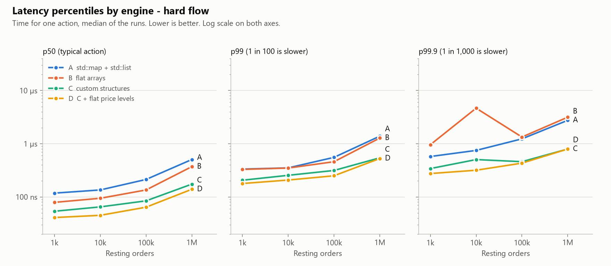
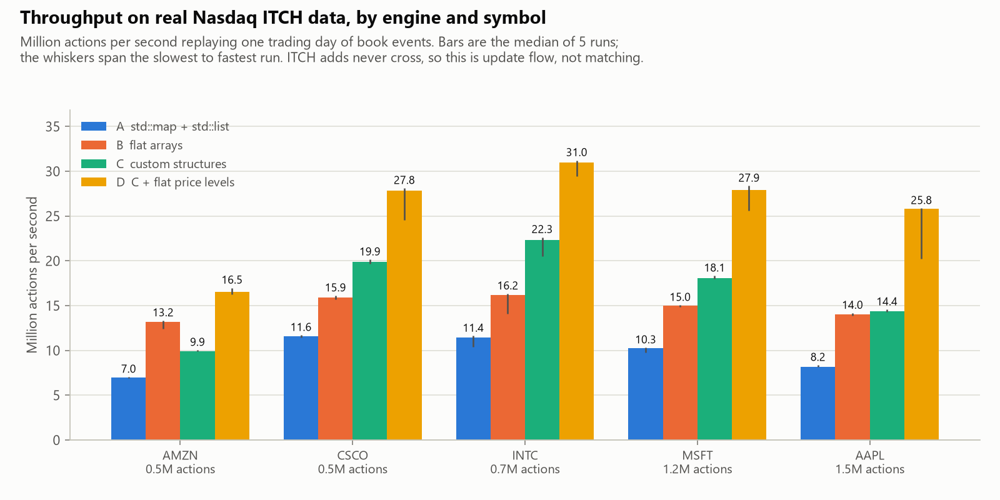
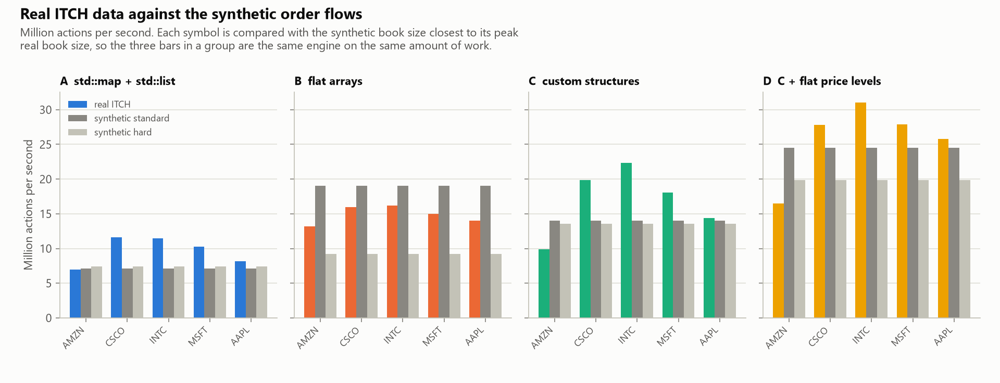

# Limit Order Book & Matching Engine

**[Read the full report (PDF)](report.pdf)**

A limit-order matching engine in C++17, implemented four times with different data structures
behind one interface, and benchmarked to answer one question:

**How does data-structure choice affect the latency and throughput of a limit-order matching engine?**

It supports limit and market orders, cancel, modify (cancel + replace), partial fills, price-time
priority, best bid/ask and spread, market depth, and a timestamped trade history. Prices are integer
cents. Python is used only to run the benchmarks, preprocess market data and draw the charts.

The engines are benchmarked on two synthetic order flows and on a real Nasdaq trading day replayed from
TotalView-ITCH 5.0 data - with the important caveat, explained in
[Real exchange data (ITCH)](#real-exchange-data-itch), that ITCH is a feed of book events the exchange
has already matched, so it tests real order-book *update* flow rather than real matching.

## The four engines

All four derive from `OrderBookBase`, pass the same tests, and produce identical trades.

| Engine | Price levels | Queue at each price | Order-id index |
|---|---|---|---|
| **A** – baseline | `std::map` | `std::list` | `std::unordered_map` |
| **B** – flat arrays | `std::vector` indexed by price | `std::vector`, cancelled slots removed in batches | `std::deque` indexed by the id (hash-map fallback for large ids) |
| **C** – custom | `std::map` (pool-allocated) | intrusive doubly-linked list in a pre-allocated node pool, 32-byte nodes | open-addressing hash map |
| **D** – C with flat levels | array indexed by price, as in B | as C | as C |

Four intermediate versions (C1–C4) add C's changes to A one at a time, for the ablation below.

## Build and run

Requires CMake 3.15+ and a C++17 compiler.

**Windows** (tested with WinLibs MinGW-w64 GCC 16.2; `g++` and `cmake` on PATH):

```
cmake -S . -B build -G "MinGW Makefiles"
cmake --build build
.\build\tests.exe
.\build\demo.exe
```

**Linux** (GCC 9+ or Clang with a C++17 standard library that has `<memory_resource>`):

```
cmake -S . -B build
cmake --build build
./build/tests
./build/demo
```

The engines, tests and demo are standard C++17. They have only been built and run on Windows so far.
The benchmark is Windows-only (it uses the Windows API to measure memory) and CMake skips it elsewhere.

### Benchmark (Windows)

```
pip install matplotlib
python analysis\run_bench.py       # 220 runs, about 20 minutes; rewrites results\*.csv
python analysis\plot_results.py    # prints the tables, writes results\*.png
```

A single run: `.\build\bench.exe <engine> [bookSize] [actions] [run] [outDir] [standard|hard]`,
where `<engine>` is one of `A B C1 C2 C3 C4 D`.

To replay real market data instead, see [Real exchange data (ITCH)](#real-exchange-data-itch).

## Project structure

```
Order.hpp               Order, Trade, Side, OrderType
OrderBookBase.hpp/.cpp  interface for every engine + rules shared by all (validation, timestamps, trade history, modify)
OrderBook.hpp/.cpp      engine A, and C1 (A + memory pool)
FlatBook.hpp/.cpp       engine B
IntrusiveBook.hpp       engines C2, C3, C (= C4) and D: one template with pluggable index, pool and price levels
Engines.hpp/.cpp        makeBook("A" | "B" | "C1" | "C2" | "C3" | "C4" | "D")
OrderFlow.hpp/.cpp      seeded order-flow generator (standard and hard flows)
ItchReplay.hpp/.cpp     reader for the real-market action files produced from Nasdaq ITCH data
tests.cpp               40 tests per engine + a differential test + the real-data replay test
bench.cpp               benchmark executable (-O3): synthetic flows and ITCH replay
main.cpp                small demo
analysis/               run_bench.py, plot_results.py                                  (synthetic)
                        itch_download.py, itch_extract.py, run_itch.py, plot_itch.py   (real data)
results/                benchmark CSVs and charts
results_itch/           real-data CSVs and charts
results_phase3/         earlier baseline-only results
data/                   the ITCH download and the actions extracted from it (gitignored, 3.5 GB)
```

## Tests

`tests` runs the same 40 assert-based tests against each of the 7 engine variants. A differential test
then replays six seeded order flows through every engine and checks that each produces the same trades
and the same final book as engine A. Finally, if the real-market action files are present (see
[Real exchange data (ITCH)](#real-exchange-data-itch)), the same check runs on a real Nasdaq trading
day, and also asserts that no engine ever leaves the book crossed. Without that data the last test
reports that it was skipped and the rest still run.

## Benchmark method

- **Machine:** Intel Core i7-14650HX, Windows 11, GCC 16.2, `-O3 -DNDEBUG`, single thread pinned to one core.
- **Workload:** the book is filled to N resting orders (1k, 10k, 100k, 1M), then 1,000,000 generated
  actions are replayed: about 48% limit orders, 5% market orders, 37% cancels, 10% modifies. The generator
  keeps the book at N. The same seed gives the same actions for every engine.
- **Standard flow:** sequential order ids, prices within $2 of the mid (300–400 price levels in use).
- **Hard flow:** random 64-bit order ids, prices up to $50 from the mid (up to about 10,000 levels in
  use), 95% of passive orders within 20 cents of the mid.
- **Runs:** each measurement is a fresh process with 2 warm-up replays and 1 measured run; 5 runs per
  engine per size, with the engines interleaved.
- **Throughput** is timed over the whole replay. **Latency** is timed per action with the CPU cycle
  counter in a separate replay.
- **Noise rule:** two results are treated as different only if their run ranges (slowest to fastest
  run) do not overlap.

## Results

Median of 5 runs. Throughput is in million actions per second, with the slowest–fastest run in brackets.

### Throughput – standard flow

| Resting orders | A | B | C | D |
|---|---|---|---|---|
| 1k | 7.45 (6.88–8.00) | 18.50 (14.47–19.13) | 10.61 (10.24–13.52) | 25.48 (22.33–26.77) |
| 10k | 6.77 (6.42–6.95) | 17.51 (17.09–19.63) | 13.47 (12.33–13.99) | 24.02 (14.98–24.70) |
| 100k | 4.56 (3.84–4.87) | 14.27 (9.28–15.89) | 11.19 (9.65–12.06) | 18.06 (14.08–18.87) |
| 1M | 2.44 (2.38–2.46) | 8.77 (8.40–8.91) | 5.78 (5.43–5.87) | 6.84 (6.72–6.90) |

Ranking by throughput: D > B > C > A at 1k; D ~ B > C > A at 10k; D ~ B ~ C > A at 100k (the run
ranges overlap, so B and C cannot be separated there); B > D > C > A at 1M.

### Throughput – hard flow

| Resting orders | A | B | C | D |
|---|---|---|---|---|
| 1k | 8.46 (8.04–8.59) | 11.51 (11.21–11.66) | 16.61 (16.41–16.91) | 24.93 (24.55–25.37) |
| 10k | 7.47 (7.29–7.54) | 9.08 (8.88–9.27) | 13.44 (12.83–13.53) | 20.44 (20.35–20.73) |
| 100k | 3.86 (3.70–4.32) | 6.04 (5.92–6.53) | 10.56 (9.92–11.00) | 15.59 (13.87–15.83) |
| 1M | 1.89 (1.77–1.93) | 2.58 (2.32–2.60) | 5.78 (5.50–5.91) | 6.84 (5.64–6.99) |

Ranking by throughput: D > C > B > A at 1k, 10k and 100k; D ~ C > B > A at 1M. B's lead over A falls
from x2.5–x3.6 on the standard flow to x1.2–x1.6 here, so most of it depended on sequential order ids
and a narrow price band. D never gives up more than 15% of its standard-flow throughput.


### Latency per action (p50 / p99 / p99.9, nanoseconds)

Standard flow:

| Resting orders | A | B | C | D |
|---|---|---|---|---|
| 1k | 118 / 350 / 1129 | 42 / 207 / 443 | 66 / 261 / 477 | 37 / 177 / 297 |
| 10k | 138 / 396 / 2111 | 40 / 219 / 656 | 67 / 250 / 450 | 42 / 197 / 314 |
| 100k | 202 / 583 / 4205 | 43 / 264 / 4217 | 83 / 281 / 588 | 55 / 223 / 355 |
| 1M | 397 / 1125 / 5398 | 43 / 412 / 2688 | 186 / 514 / 3995 | 130 / 476 / 957 |

Hard flow:

| Resting orders | A | B | C | D |
|---|---|---|---|---|
| 1k | 110 / 320 / 569 | 80 / 341 / 1066 | 54 / 207 / 330 | 40 / 173 / 265 |
| 10k | 126 / 356 / 1535 | 94 / 354 / 5318 | 65 / 254 / 466 | 45 / 206 / 337 |
| 100k | 224 / 649 / 4532 | 139 / 521 / 3779 | 86 / 324 / 920 | 62 / 250 / 468 |
| 1M | 510 / 1413 / 4409 | 374 / 1289 / 3572 | 184 / 565 / 3719 | 137 / 519 / 800 |

D has the best or joint-best p99.9 at every size on both flows. B's is the worst of the four at 100k
on the standard flow (4217 ns, no better than A's) and at 10k on the hard flow (5318 ns, worse than
A's): its lazily-removed dead slots have to be cleaned up eventually, and the clean-up all lands on
one unlucky action.

Each timing includes about 6 ns of measurement overhead.




### Ablation – standard flow

Throughput after adding each change to the one before. The bracket is the change from the previous
step; "noise" means the run ranges overlap.

| Resting orders | A | + pool | + intrusive list | + hash map | + layout (= C) | + flat levels (= D) |
|---|---|---|---|---|---|---|
| 1k | 7.45 | 6.20 (noise) | 7.69 (noise) | 12.84 (+67%) | 10.61 (noise) | 25.48 (+140%) |
| 10k | 6.77 | 6.07 (−10%) | 6.99 (+15%) | 13.25 (+90%) | 13.47 (noise) | 24.02 (+78%) |
| 100k | 4.56 | 3.79 (noise) | 5.56 (+47%) | 11.14 (+100%) | 11.19 (noise) | 18.06 (+61%) |
| 1M | 2.44 | 2.72 (+12%) | 3.29 (+21%) | 5.57 (+70%) | 5.78 (noise) | 6.84 (+18%) |

The memory pool — the change I expected to matter most after Phase 3 — is the only step that never
clearly helps: noise at 1k and 100k, −10% at 10k, +12% at 1M. Replacing the hash map is the biggest
single win, and replacing `std::map` with a flat array of price levels is bigger still.


### Book memory

MB used by the book right after filling it → after 1,000,000 more actions (the number of resting
orders is the same at both points). Measured as process growth through the Windows API; values for
the 1k book are approximate.

| Resting orders | Flow | A | B | C | D |
|---|---|---|---|---|---|
| 1k | standard | 0.15 → 0.00 | 0.27 → 14.21 | 0.24 → 0.21 | 0.25 → 0.25 |
| 10k | standard | 1.19 → 1.23 | 0.96 → 17.23 | 0.93 → 1.17 | 0.95 → 1.00 |
| 100k | standard | 11.47 → 12.16 | 8.06 → 28.71 | 7.98 → 8.39 | 8.46 → 8.43 |
| 1M | standard | 122.48 → 121.09 | 89.66 → 120.48 | 107.19 → 107.20 | 107.23 → 107.24 |
| 1k | hard | 0.14 → 0.23 | 1.33 → 1.59 | 0.22 → 0.21 | 0.36 → 0.35 |
| 10k | hard | 1.27 → 1.10 | 2.34 → 4.25 | 0.95 → 1.43 | 1.09 → 1.05 |
| 100k | hard | 12.34 → 12.64 | 13.90 → 21.17 | 8.89 → 9.14 | 8.63 → 8.60 |
| 1M | hard | 123.16 → 121.81 | 121.00 → 144.32 | 108.22 → 108.12 | 107.32 → 107.50 |

A, C and D stay flat, as they should: the book holds the same number of orders at both points. B is
the exception, and the next section explains why.


More output is in `results/`: the per-run CSVs, latency by action type, and latency distribution charts
at 1M orders for both flows. `python analysis\plot_results.py` reprints every table.

### Why engine B's memory spikes

B is the only engine whose memory grows while the number of resting orders stays the same
(0.27 → 14.21 MB at a 1k book on the standard flow). Both of B's "index by the number itself instead
of hashing" tricks contribute, and only one of them was intended.

**1. The order-id array (a real design cost).** `direct_` is a `std::deque<Slot>` indexed by order
id, so finding an order is one subtraction and one load instead of a hash. It therefore has to be as
long as the *largest id ever seen*, not as long as the book. The standard flow issues sequential ids,
so 1,000,000 actions use about 527,000 ids: 527,000 × 24 bytes = **12.1 MB**, whatever the book size.
That is why the growth is almost the same at 1k and at 10k. Nothing can be freed — an array indexed
by id cannot have holes punched out of it — so this is the price of the design, not a bug. (The hard
flow uses random 64-bit ids, which skip `direct_` entirely and go to the `overflow_` hash map, so it
pays nothing here.)

**2. Price levels keeping buffers they no longer need (a bug, now fixed).** Each price level is a
`std::vector<Order>`, and `tidy()` used to empty a level with `clear()`, which keeps the allocated
buffer "ready for the next orders". That is right for the handful of levels at the best price, which
empty and refill constantly, but wrong for the book as a whole: over a long run the book touches far
more prices than it ever holds orders at, and each one of those kept a buffer sized to its own peak —
including the slack of up to `kSlack` (32) dead slots per level that the lazy-deletion scheme leaves
behind. After 1M actions on the hard flow, 9,832 *empty* levels were still holding 199,383 order
slots (**7.6 MB**) for 999 live orders.

The fix is one branch in `tidy()`: when a level empties, release the buffer
(`std::vector<Order>().swap(level.orders)`) unless it is already small (≤ `kKeepSlots` = 8 slots),
which keeps the hot levels allocation-free. Slots held by empty levels at a 1k book:

| Flow | Before | After |
|---|---|---|
| standard | 41,778 slots (1.6 MB) | 4,239 slots (0.16 MB) |
| hard | 199,383 slots (7.6 MB) | 11,615 slots (0.44 MB) |

Memory after the flow, old and new binaries run back to back (3 runs each):

| Resting orders | Flow | Before | After |
|---|---|---|---|
| 1k | standard | 15.80 MB | 14.20 MB |
| 10k | standard | 18.02 MB | 17.22 MB |
| 100k | standard | 30.02 MB | 28.75 MB |
| 1M | standard | 124.1 MB | 121.6 MB |
| 1k | hard | 9.21 MB | 1.50 MB |
| 10k | hard | 8.56 MB | 4.25 MB |
| 100k | hard | 24.30 MB | 21.20 MB |
| 1M | hard | 144.1 MB | 144.2 MB |

The hard flow at 1k improves by 84%; the standard flow barely moves, because there the 12.1 MB id
array dominates and that part is inherent. At a 1M book nothing changes, because then the book really
is holding a million orders. Throughput is unchanged: in interleaved runs every comparison has
overlapping run ranges (the noise rule), the largest median gap being −8% on the standard flow at 1k,
where levels empty and refill most often. Every table above was re-measured with the fix in place.


## Real exchange data (ITCH)

The synthetic flows above are my own invention, so the obvious objection is that they flatter whichever
engine happens to suit them. This phase replays a real trading day through the same four engines:
**30 December 2019 on Nasdaq, from the free TotalView-ITCH 5.0 sample file** (3.5 GB gzipped,
266 million messages), for five liquid symbols.

### What this tests, and what it does not

**ITCH is a feed of book events Nasdaq has already matched, not the raw order flow that arrived at the
exchange.** Every message says what *happened* to the order book — an order was added, cancelled,
deleted, replaced or executed. During continuous trading an Add Order message therefore never crosses
the book: had the incoming order been executable, Nasdaq would have matched it and published execution
messages instead.

So this measures the engines on **real order-book update flow** — real order-id patterns, real price
clustering, real book sizes, a real mix of adds, cancels and executions — and **not on real matching**.
The matching path is barely touched. Nothing here says how well an engine matches.

That claim is measured, not assumed: across all 4.4 million real actions, every engine produced
**zero trades** and the book was **never crossed, not once**. See the correctness table below.

### The data

`analysis/itch_extract.py` streams the gzipped file (it is never loaded — ~8.3 GB raw) and converts one
symbol's messages into the engine's existing actions:

| ITCH message | Engine action |
|---|---|
| `A`, `F` — add order (without / with attribution) | add a limit order |
| `D` — order delete (whole order gone) | cancel |
| `X` — order cancel (part of an order gone) | modify to the smaller quantity |
| `E`, `C` — order executed (with / without price) | modify to the smaller quantity, or cancel if nothing is left |
| `U` — order replace (new price, size and id) | modify to the new price and quantity |

Measured window: **09:30–16:00**, continuous trading only. Before the opening cross the displayed book
is legitimately *crossed* — buy and sell orders for the 09:30 auction pile up with bids above asks and
the exchange holds them rather than matching them — so replaying the pre-open would have the engines
trade orders Nasdaq was still holding. The extractor still tracks the book from 04:00, so it knows
exactly what was resting at 09:30 and writes that out as a **prefill** block, which the benchmark
applies untimed before measuring, exactly as it does with the synthetic flows.

| Symbol | ITCH messages = actions | adds | cancels | modifies | 09:30 book | peak book | price span touched |
|---|---|---|---|---|---|---|---|
| AAPL | 1,477,252 | 694,517 | 668,258 | 114,477 | 828 | 27,102 | $0.01 – $199,999.00 |
| MSFT | 1,188,106 | 573,145 | 551,280 | 63,681 | 1,075 | 22,996 | $0.01 – $199,999.99 |
| INTC | 740,571 | 351,413 | 343,027 | 46,131 | 136 | 8,605 | $0.01 – $199,999.99 |
| CSCO | 529,009 | 253,867 | 240,855 | 34,287 | 259 | 13,405 | $0.01 – $199,999.99 |
| AMZN | 477,185 | 227,054 | 191,717 | 58,414 | 1,724 | 37,063 | $0.01 – $199,999.00 |

4,412,123 actions in total. One ITCH message becomes exactly one engine action, so the two counts are
the same number. Of 266 million messages in the file, only 40 carried a price that was not a whole
cent (rounded, and counted), and 29 adds had no usable price and were skipped.

Three honest caveats about the mapping:

1. The engine's `modifyOrder` is cancel + re-add, so it sends the order to the **back** of its price
   level. For `U` (replace) that is exactly right — a real replace loses time priority too. For `X` and
   `E` it is not: shrinking an order, or partially filling it, keeps its place in the real queue. The
   engines have no "reduce in place" call and this phase does not change them. The set of resting
   orders and their quantities stays correct; only the order *within* one price level differs.
2. `U` gives the order a brand-new ITCH reference number. Rather than emit a cancel and an add, the
   extractor keeps using the original id inside the engine and remembers that later messages about the
   new reference mean that same order — so one message stays one action and the book is identical.
3. `E`, `C` and `X` carry a *delta* (shares executed or cancelled), so the extractor keeps its own copy
   of each tracked order's resting quantity to turn deltas into the absolute quantity `modifyOrder` wants.

### Getting the data and running it

The data is deliberately not in git (`data/` is gitignored — it is 3.5 GB).

```
python analysis\itch_download.py     # 3.5 GB; parallel ranged requests, resumable
python analysis\itch_extract.py      # streams it, writes data\itch\<SYMBOL>.actions
python analysis\run_itch.py          # 100 runs (5 symbols x 4 engines x 5 runs)
python analysis\plot_itch.py         # prints the tables, writes results_itch\*.png
```

A single replay: `.\build\bench.exe replay <engine> <actionFile> [run] [outDir] [maxActions]`.
Measurement is identical to the synthetic benchmark — same warm-ups, same single measured run per
process, same 5 interleaved runs, same percentiles, same noise rule — so the two are directly
comparable. **Engine B needs about 1.9 GB per process on real prices** (see below); D needs about
0.5 GB.

### Correctness

`tests.exe` replays the real data through **all seven** engine variants and checks that they finish
identical — same best bid and ask, same depth at every price, same order count, same quantity on every
individual order id, same trades — and that no engine ever leaves the book crossed.

| Symbol | Actions replayed | Resting at the end | Engines agreeing | Trades from the prefill | Trades during the replay | Times crossed |
|---|---|---|---|---|---|---|
| AAPL | 1,000,000 | 22,019 | 7 / 7 | 0 | 0 | 0 |
| MSFT | 1,000,000 | 19,642 | 7 / 7 | 0 | 0 | 0 |
| INTC | 740,571 | 8,522 | 7 / 7 | 0 | 0 | 0 |
| CSCO | 529,009 | 13,271 | 7 / 7 | 0 | 0 | 0 |
| AMZN | 477,185 | 37,061 | 7 / 7 | 0 | 0 | 0 |

(The test caps a symbol at 1,000,000 actions to stay quick; the benchmark replays the whole day.)
The zeros in the last three columns are the honesty point, measured: real ITCH adds never cross.

### Results

100 runs: 5 symbols x 4 engines x 5 runs, each a fresh process, interleaved. Median of the 5 runs,
with the slowest–fastest run in brackets. Every run finished with all four engines on an identical
book, and the book was never crossed.

| Symbol | Engine | M actions/s | [spread] | vs A | p50 ns | p99 ns | p99.9 ns | worst | book MB | after MB |
|---|---|---|---|---|---|---|---|---|---|---|
| AMZN (477k actions) | A | 6.50 | [6.36–6.54] | – | 148 | 348 | 2326 | 60 µs | 0.60 | 5.12 |
| | B | 11.93 | [7.50–12.81] | x1.83 | 80 | 260 | 1050 | 185 µs | 1938 | 1942 |
| | C | 9.36 | [5.87–9.42] | x1.44 (noise) | 107 | 265 | 2085 | 237 µs | 3.69 | 4.12 |
| | D | **4.35** | [3.57–4.51] | **x0.67** | 47 | 196 | 661 | **48.7 ms** | 236 | 463 |
| CSCO (529k) | A | 11.39 | [9.95–11.46] | – | 91 | 201 | 303 | 45 µs | 0.16 | 1.94 |
| | B | 15.92 | [15.00–16.03] | x1.40 | 64 | 200 | 455 | 572 µs | 1937 | 1940 |
| | C | 19.93 | [19.50–20.39] | x1.75 | 51 | 140 | 234 | 27 µs | 1.13 | 1.23 |
| | D | **28.93** | [26.25–29.34] | **x2.54** | 39 | 97 | 186 | 48 µs | 231 | 231 |
| INTC (741k) | A | 11.50 | [11.28–11.66] | – | 90 | 203 | 382 | 31 µs | 0.11 | 1.28 |
| | B | 16.40 | [15.62–16.47] | x1.43 | 65 | 188 | 357 | 90 µs | 1939 | 1940 |
| | C | 22.71 | [21.13–22.84] | x1.98 | 46 | 136 | 238 | 28 µs | 0.92 | 1.09 |
| | D | **32.57** | [32.35–33.16] | **x2.83** | 35 | 78 | 140 | 27 µs | 230 | 230 |
| MSFT (1.19M) | A | 10.31 | [10.13–10.34] | – | 98 | 233 | 428 | 56 µs | 0.38 | 3.22 |
| | B | 14.22 | [13.71–15.38] | x1.38 | 69 | 195 | 371 | 335 µs | 1937 | 1940 |
| | C | 18.09 | [18.00–18.24] | x1.76 | 57 | 154 | 263 | 32 µs | 2.07 | 2.34 |
| | D | **28.70** | [27.99–28.87] | **x2.79** | 39 | 103 | 240 | 33 µs | 232 | 232 |
| AAPL (1.48M) | A | 7.57 | [7.46–8.13] | – | 124 | 303 | 943 | 48 µs | 0.39 | 3.88 |
| | B | 13.23 | [12.18–13.87] | x1.75 | 72 | 220 | 605 | 245 µs | 1940 | 1941 |
| | C | 13.76 | [12.43–14.41] | x1.82 | 70 | 188 | 454 | 35 µs | 2.25 | 2.82 |
| | D | 14.27 | [12.79–14.92] | x1.88 | 45 | 115 | 488 | **44.9 ms** | 232 | 461 |

`book MB` is one book after the 09:30 prefill, `after MB` the same book after the whole day.

Ranking by throughput, best first (`~` = within noise of its neighbour):

| Symbol | Throughput | p99 | p99.9 |
|---|---|---|---|
| AMZN | B ~ C ~ A > D | D > B ~ C ~ A | D ~ B ~ C ~ A |
| CSCO | D > C > B > A | D > C > B ~ A | D > C > A ~ B |
| INTC | D > C > B > A | D > C > B > A | D > C > B ~ A |
| MSFT | D > C > B > A | D > C > B > A | D ~ C > B ~ A |
| AAPL | D ~ C ~ B > A | D > C ~ B > A | C ~ D ~ B ~ A |



Three things stand out, and all three are about the *tails*, not the typical action:

1. **D has the best p50 on every single symbol** (35–47 ns, against A's 90–148 ns) — indexing price
   levels by price is still the best idea in the project. It also wins throughput outright on CSCO,
   INTC and MSFT, by x2.5–x2.8 over A.
2. **D is nevertheless the *worst* engine on AMZN** (x0.67 of A) and no better than B or C on AAPL —
   despite the best p50 in both cases. One single action is responsible. See below.
3. **A, C and D all beat their own synthetic results on the three smaller books** (CSCO, INTC, MSFT:
   x1.19–x1.70 of their standard-flow throughput). Real flow is in one way *easier* than my synthetic
   flow: its mix is 47.6% adds, 45.2% plain cancels and 7.2% modifies, with **no market orders at
   all**, whereas the synthetic mix has 10% modifies and 5% market orders — the two most expensive
   actions in every engine. They fall behind on AAPL and AMZN, the two biggest books, which are also
   the two compared against a synthetic book less than half their size. B is the one engine that is
   below its standard-flow result everywhere (x0.68–x0.94); see the note under the next table.


### Real data against the synthetic flows

Each symbol is compared with the synthetic book size closest to its peak real book size. That is
10,000 orders for all five, which is a fair match for INTC (8.6k) and CSCO (13.4k) but understates
MSFT (23.0k), AAPL (27.1k) and especially AMZN (37.1k) — those three would sit between the synthetic
10k and 100k rows, so their synthetic comparison is a little flattering.

| Symbol | Engine | real M/s | synthetic standard | synthetic hard | real vs standard | real vs hard |
|---|---|---|---|---|---|---|
| AMZN | A | 6.50 | 6.77 | 7.47 | x0.96 (noise) | x0.87 |
| | B | 11.93 | 17.51 | 9.08 | x0.68 | x1.31 (noise) |
| | C | 9.36 | 13.47 | 13.44 | x0.69 | x0.70 |
| | D | 4.35 | 24.02 | 20.44 | **x0.18** | **x0.21** |
| CSCO | A | 11.39 | 6.77 | 7.47 | x1.68 | x1.53 |
| | B | 15.92 | 17.51 | 9.08 | x0.91 | x1.75 |
| | C | 19.93 | 13.47 | 13.44 | x1.48 | x1.48 |
| | D | 28.93 | 24.02 | 20.44 | x1.20 | x1.42 |
| INTC | A | 11.50 | 6.77 | 7.47 | x1.70 | x1.54 |
| | B | 16.40 | 17.51 | 9.08 | x0.94 | x1.81 |
| | C | 22.71 | 13.47 | 13.44 | x1.69 | x1.69 |
| | D | 32.57 | 24.02 | 20.44 | x1.36 | x1.59 |
| MSFT | A | 10.31 | 6.77 | 7.47 | x1.52 | x1.38 |
| | B | 14.22 | 17.51 | 9.08 | x0.81 | x1.57 |
| | C | 18.09 | 13.47 | 13.44 | x1.34 | x1.35 |
| | D | 28.70 | 24.02 | 20.44 | x1.19 | x1.40 |
| AAPL | A | 7.57 | 6.77 | 7.47 | x1.12 | x1.01 (noise) |
| | B | 13.23 | 17.51 | 9.08 | x0.76 | x1.46 |
| | C | 13.76 | 13.47 | 13.44 | x1.02 (noise) | x1.02 (noise) |
| | D | 14.27 | 24.02 | 20.44 | x0.59 | x0.70 |

The ranking changes on real data for exactly one engine — D — and in exactly the two cases where it
hits the stall described below. B also loses its synthetic-flow advantage: it is x1.31–x1.81 of its own
*hard*-flow result but only x0.68–x0.94 of its *standard*-flow result, on every symbol. That is the
same lesson as Phase 4: B's standard-flow lead depended on sequential order ids feeding its array
index, and real ITCH reference numbers run into the tens of millions, so nearly all of them exceed its
4-million-entry direct array and fall back to the hash map.



### What the $0.01 / $199,999.99 orders are

Both of the effects below are caused by a tiny number of orders at the extreme ends of the price range,
so it is worth establishing what they actually are. Across all five symbols and the whole session,
**415 adds** are priced at or below $1 or at or above $100,000 — against 2.1 million adds inside the
measured windows.

$199,999.99 is not arbitrary: it is **the highest limit price Nasdaq's system accepts**, and the `OUCH`
specification notes that an order entered above it is treated as a market order instead. So these
orders sit at the very top and bottom of the permitted range.

Scanning the raw feed for attribution (ITCH publishes attributed orders as `F` messages carrying an
MPID and unattributed ones as `A`) splits them cleanly in two:

- **19 exactly paired two-sided quotes** — a $0.01 buy and a $199,999.99 sell, 100 shares each —
  attributed to five market-participant MPIDs (`NITE`, `UBSS`, `NEED`, `VERT`, `DADA`; `NITE` is
  Knight/Virtu Americas and `UBSS` is UBS Securities, both long-standing Nasdaq liquidity providers).
  Every one of them arrives **before 09:30**. These match the SEC's own definition of a **stub quote**:
  "an offer to buy or sell a stock at a price so far away from the prevailing market that it is not
  intended to be executed, such as an order to buy at a penny or an offer to sell at $100,000" — a
  placeholder a market maker posts in order to hold a two-sided quote. The SEC approved rules
  effectively prohibiting stub quotes from 6 December 2010, by requiring market makers to quote within
  a band of the NBBO; those minimum-quoting requirements apply during *regular market hours*, which is
  consistent with these surviving only in the pre-open.
- **The other ~396** are unattributed, almost all on the buy side, and typically **one share** at $0.01
  or $1.00. They are not market-maker quotes, and the stub-quote label does not fit them.

The orders that matter for the engines are the 19 $199,999.99 **asks**, because those are what stretch
a price-indexed array upwards, and they all land in the pre-open — which is why every engine's array is
already stretched before the measured window begins.

### Why D is fastest on three symbols and collapses on two

D keeps a **separate array per side**, each based at `first price seen on that side − 1024 cents`, and
each has to span every price that side ever touches. A single ask at $199,999.99 therefore stretches
the ask array to about 20 million levels the moment it arrives. `ListLevel` is 12 bytes, so that is
229 MiB of array for one side — which is exactly what the `book MB` column shows for D on every symbol.

A stretched array is not in itself slow — reads are still one subtraction. The problem is *growing it
downwards*. `FlatLevelSet::cover` extends downwards with `levels_.insert(levels_.begin(), extra, …)`,
which allocates a new buffer and shifts every element. Once the array is 20 million levels long, one
such insert costs tens of milliseconds, and the freed old buffer is not returned to the OS, so the
book's footprint roughly doubles.

Whether that ever happens comes down to whether an ask later arrives *below* the base set by the first
ask of the day — and whether that happens before or after the $199,999.99 order stretched the array:

| Symbol | First ask of the day | Ask array base | First later ask below the base | When | D's worst action |
|---|---|---|---|---|---|
| AMZN | $1,879.90 | $1,869.66 | $1,869.42 (by 24¢) | measured flow, action #72,751 | **48.7 ms** |
| AAPL | $299.90 | $289.66 | $289.47 (by 19¢) | measured flow, action #64 | **44.9 ms** |
| MSFT | $176.00 | $165.76 | $161.00 | prefill #17 — *before* the stretch, so cheap, and untimed | 33 µs |
| CSCO | $54.00 | $43.76 | never happens | – | 48 µs |
| INTC | $60.37 | $50.13 | never happens | – | 27 µs |

So the whole difference is luck about the first quote of the day:

- **CSCO and INTC** opened with an ask ($54.00, $60.37) comfortably above where they traded all day, so
  the 1024-cent padding was never used up and the array never grew downwards. D is cleanly fastest.
- **MSFT** did go below its base, but at prefill action 17 — while the array was still tiny, and in the
  untimed prefill. By the time the $199,999.99 ask stretched it (prefill action 171) the downward move
  was already done. D is cleanly fastest.
- **AAPL** opened at $299.90, giving a base of $289.66, and 64 actions into the measured day an
  ordinary ask arrived at $289.47 — **19 cents too low**. That one action took 44.9 ms: 43% of D's
  entire 103 ms replay, spent in a single `insert`. AMZN missed by 24 cents and was hit twice: timing
  each action individually puts its two slowest at roughly 43 ms and 18 ms, together about 55% of its
  110 ms replay.

Note what the stalling action *is*: not the exotic $199,999.99 order, but a completely ordinary quote
19 cents below where the stock opened. The extreme order does the damage silently, hours earlier, by
stretching the array; the bill is paid by whichever innocent order first falls off the bottom.

This is the clearest result of the whole project. D has the best typical latency of any engine on both
synthetic and real flow, and it is the only engine whose *ranking* real data changes — because a
price-indexed array makes the cost of an action depend on the range of prices the market has visited,
not just on the work that action does. C, which keeps its levels in a `std::map`, pays about 70 ns
instead of 35 ns per action and is never surprised: its worst action on real data is 27–237 µs, up to
three orders of magnitude better than D's.

### Why B always needs about 1.9 GB

B is uniformly 1,937–1,942 MB on every symbol, where D ranges from 230 to 463 MB. Two differences:

1. **B sizes both sides together.** `FlatBook::cover` keeps a single `basePrice_` and resizes
   `bidLevels_` *and* `askLevels_` to the same span, so the $0.01 bid and the $199,999.99 ask between
   them stretch *both* arrays over the full 20-million-cent range. D's per-side arrays mean only the
   side that actually saw an extreme price pays.
2. **B's level is four times bigger.** B's `Level` is 48 bytes — it owns a whole `std::vector<Order>`
   (24 bytes) plus a head index, a live count and a sequence number. D's `ListLevel` is 12 bytes: just
   the two ends of an intrusive linked list and a count, because the orders themselves live in a shared
   node pool.

Two arrays of 20 million 48-byte levels is **1,831 MiB**, which is most of the measured 1,940 MiB; the
remaining ~110 MiB is the spare capacity those vectors keep after growing, the order buffers of the
levels actually in use, and the order-id index. B also escapes D's stall, for an unglamorous reason:
because both of its arrays stretch together during the untimed prefill, there is nothing left to grow
during the measured flow. Its worst actions (90–572 µs) are the batched clean-up of dead slots inside a
price level, not array growth.

Memory on real data, after the full day:

| Engine | AMZN | CSCO | INTC | MSFT | AAPL |
|---|---|---|---|---|---|
| A | 5.12 MB | 1.94 MB | 1.28 MB | 3.22 MB | 3.88 MB |
| B | 1,942 MB | 1,940 MB | 1,940 MB | 1,940 MB | 1,941 MB |
| C | 4.12 MB | 1.23 MB | 1.09 MB | 2.34 MB | 2.82 MB |
| D | 463 MB | 231 MB | 230 MB | 232 MB | 461 MB |

A and C pay only for the price levels actually in use (1,716–5,603 of them). B and D pay for the range,
whether or not anything is resting in it.
## Notes

Built with AI coding assistance. The design decisions and analysis are my own.
