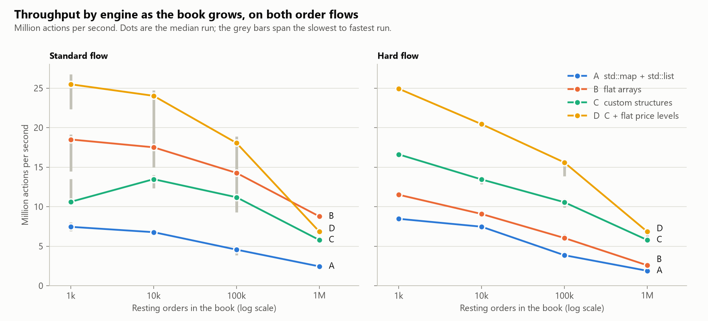
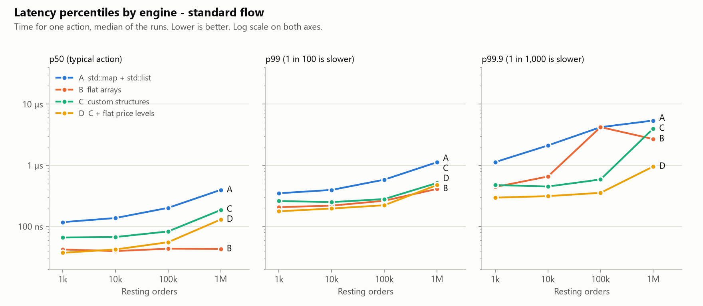
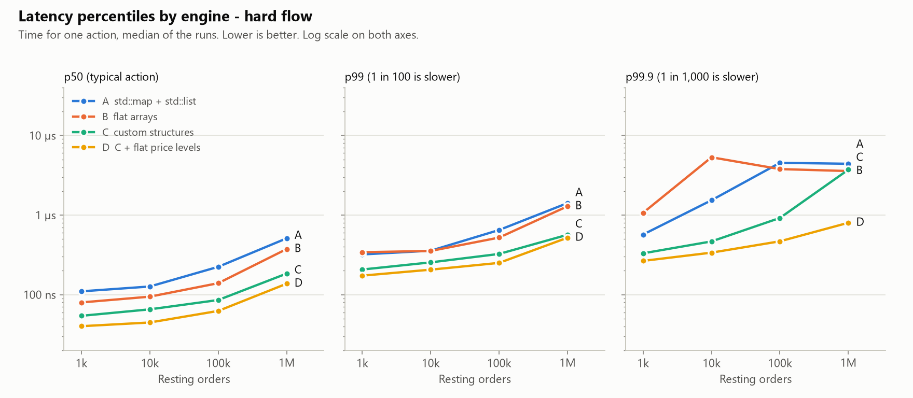
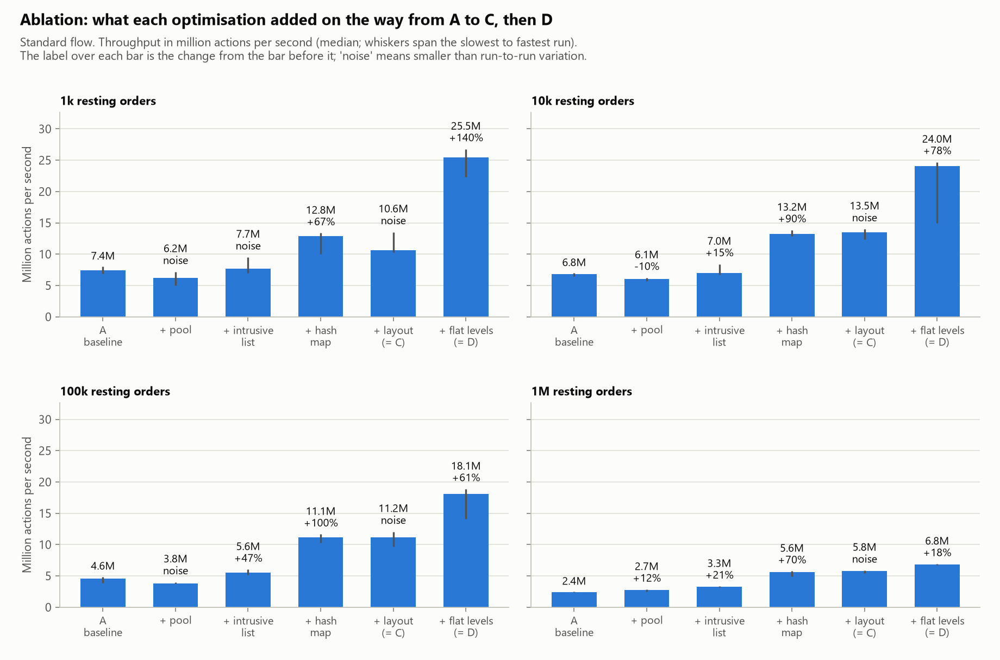
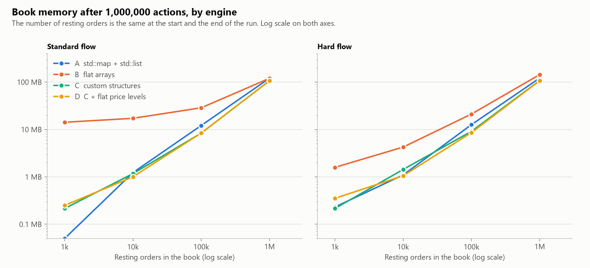

# Limit Order Book & Matching Engine

**[Read the full report (PDF)](report.pdf)**

A limit-order matching engine in C++17, implemented four times with different data structures
behind one interface, and benchmarked to answer one question:

**How does data-structure choice affect the latency and throughput of a limit-order matching engine?**

It supports limit and market orders, cancel, modify (cancel + replace), partial fills, price-time
priority, best bid/ask and spread, market depth, and a timestamped trade history. Prices are integer
cents. Python is used only to run the benchmarks and draw the charts.

## The four engines

All four derive from `OrderBookBase`, pass the same tests, and produce identical trades.

| Engine | Price levels | Queue at each price | Order-id index |
|---|---|---|---|
| **A** – baseline | `std::map` | `std::list` | `std::unordered_map` |
| **B** – flat arrays | `std::vector` indexed by price | `std::vector`, cancelled slots removed in batches | `std::deque` indexed by the id (hash-map fallback for large ids) |
| **C** – custom | `std::map` (pool-allocated) | intrusive doubly-linked list in a pre-allocated node pool, 32-byte nodes | open-addressing hash map |
| **D** – C with flat levels | array indexed by price, as in B | as C | as C |

Four intermediate versions (C1–C4) add C's changes to A one at a time, for the ablation below.

## Build and run

Requires CMake 3.15+ and a C++17 compiler.

**Windows** (tested with WinLibs MinGW-w64 GCC 16.2; `g++` and `cmake` on PATH):

```
cmake -S . -B build -G "MinGW Makefiles"
cmake --build build
.\build\tests.exe
.\build\demo.exe
```

**Linux** (GCC 9+ or Clang with a C++17 standard library that has `<memory_resource>`):

```
cmake -S . -B build
cmake --build build
./build/tests
./build/demo
```

The engines, tests and demo are standard C++17. They have only been built and run on Windows so far.
The benchmark is Windows-only (it uses the Windows API to measure memory) and CMake skips it elsewhere.

### Benchmark (Windows)

```
pip install matplotlib
python analysis\run_bench.py       # 220 runs, about 20 minutes; rewrites results\*.csv
python analysis\plot_results.py    # prints the tables, writes results\*.png
```

A single run: `.\build\bench.exe <engine> [bookSize] [actions] [run] [outDir] [standard|hard]`,
where `<engine>` is one of `A B C1 C2 C3 C4 D`.

## Project structure

```
Order.hpp               Order, Trade, Side, OrderType
OrderBookBase.hpp/.cpp  interface for every engine + rules shared by all (validation, timestamps, trade history, modify)
OrderBook.hpp/.cpp      engine A, and C1 (A + memory pool)
FlatBook.hpp/.cpp       engine B
IntrusiveBook.hpp       engines C2, C3, C (= C4) and D: one template with pluggable index, pool and price levels
Engines.hpp/.cpp        makeBook("A" | "B" | "C1" | "C2" | "C3" | "C4" | "D")
OrderFlow.hpp/.cpp      seeded order-flow generator (standard and hard flows)
tests.cpp               40 tests run against every engine + a differential test
bench.cpp               benchmark executable (-O3)
main.cpp                small demo
analysis/               run_bench.py, plot_results.py
results/                benchmark CSVs and charts
results_phase3/         earlier baseline-only results
```

## Tests

`tests` runs the same 40 assert-based tests against each of the 7 engine variants. A differential test
then replays six seeded order flows through every engine and checks that each produces the same trades
and the same final book as engine A.

## Benchmark method

- **Machine:** Intel Core i7-14650HX, Windows 11, GCC 16.2, `-O3 -DNDEBUG`, single thread pinned to one core.
- **Workload:** the book is filled to N resting orders (1k, 10k, 100k, 1M), then 1,000,000 generated
  actions are replayed: about 48% limit orders, 5% market orders, 37% cancels, 10% modifies. The generator
  keeps the book at N. The same seed gives the same actions for every engine.
- **Standard flow:** sequential order ids, prices within $2 of the mid (300–400 price levels in use).
- **Hard flow:** random 64-bit order ids, prices up to $50 from the mid (up to about 10,000 levels in
  use), 95% of passive orders within 20 cents of the mid.
- **Runs:** each measurement is a fresh process with 2 warm-up replays and 1 measured run; 5 runs per
  engine per size, with the engines interleaved.
- **Throughput** is timed over the whole replay. **Latency** is timed per action with the CPU cycle
  counter in a separate replay.
- **Noise rule:** two results are treated as different only if their run ranges (slowest to fastest
  run) do not overlap.

## Results

Median of 5 runs. Throughput is in million actions per second, with the slowest–fastest run in brackets.

### Throughput – standard flow

| Resting orders | A | B | C | D |
|---|---|---|---|---|
| 1k | 7.45 (6.88–8.00) | 18.50 (14.47–19.13) | 10.61 (10.24–13.52) | 25.48 (22.33–26.77) |
| 10k | 6.77 (6.42–6.95) | 17.51 (17.09–19.63) | 13.47 (12.33–13.99) | 24.02 (14.98–24.70) |
| 100k | 4.56 (3.84–4.87) | 14.27 (9.28–15.89) | 11.19 (9.65–12.06) | 18.06 (14.08–18.87) |
| 1M | 2.44 (2.38–2.46) | 8.77 (8.40–8.91) | 5.78 (5.43–5.87) | 6.84 (6.72–6.90) |

Ranking by throughput: D > B > C > A at 1k; D ~ B > C > A at 10k; D ~ B ~ C > A at 100k (the run
ranges overlap, so B and C cannot be separated there); B > D > C > A at 1M.

### Throughput – hard flow

| Resting orders | A | B | C | D |
|---|---|---|---|---|
| 1k | 8.46 (8.04–8.59) | 11.51 (11.21–11.66) | 16.61 (16.41–16.91) | 24.93 (24.55–25.37) |
| 10k | 7.47 (7.29–7.54) | 9.08 (8.88–9.27) | 13.44 (12.83–13.53) | 20.44 (20.35–20.73) |
| 100k | 3.86 (3.70–4.32) | 6.04 (5.92–6.53) | 10.56 (9.92–11.00) | 15.59 (13.87–15.83) |
| 1M | 1.89 (1.77–1.93) | 2.58 (2.32–2.60) | 5.78 (5.50–5.91) | 6.84 (5.64–6.99) |

Ranking by throughput: D > C > B > A at 1k, 10k and 100k; D ~ C > B > A at 1M. B's lead over A falls
from x2.5–x3.6 on the standard flow to x1.2–x1.6 here, so most of it depended on sequential order ids
and a narrow price band. D never gives up more than 15% of its standard-flow throughput.



### Latency per action (p50 / p99 / p99.9, nanoseconds)

Standard flow:

| Resting orders | A | B | C | D |
|---|---|---|---|---|
| 1k | 118 / 350 / 1129 | 42 / 207 / 443 | 66 / 261 / 477 | 37 / 177 / 297 |
| 10k | 138 / 396 / 2111 | 40 / 219 / 656 | 67 / 250 / 450 | 42 / 197 / 314 |
| 100k | 202 / 583 / 4205 | 43 / 264 / 4217 | 83 / 281 / 588 | 55 / 223 / 355 |
| 1M | 397 / 1125 / 5398 | 43 / 412 / 2688 | 186 / 514 / 3995 | 130 / 476 / 957 |

Hard flow:

| Resting orders | A | B | C | D |
|---|---|---|---|---|
| 1k | 110 / 320 / 569 | 80 / 341 / 1066 | 54 / 207 / 330 | 40 / 173 / 265 |
| 10k | 126 / 356 / 1535 | 94 / 354 / 5318 | 65 / 254 / 466 | 45 / 206 / 337 |
| 100k | 224 / 649 / 4532 | 139 / 521 / 3779 | 86 / 324 / 920 | 62 / 250 / 468 |
| 1M | 510 / 1413 / 4409 | 374 / 1289 / 3572 | 184 / 565 / 3719 | 137 / 519 / 800 |

D has the best or joint-best p99.9 at every size on both flows. B's is the worst of the four at 100k
on the standard flow (4217 ns, no better than A's) and at 10k on the hard flow (5318 ns, worse than
A's): its lazily-removed dead slots have to be cleaned up eventually, and the clean-up all lands on
one unlucky action.

Each timing includes about 6 ns of measurement overhead.





### Ablation – standard flow

Throughput after adding each change to the one before. The bracket is the change from the previous
step; "noise" means the run ranges overlap.

| Resting orders | A | + pool | + intrusive list | + hash map | + layout (= C) | + flat levels (= D) |
|---|---|---|---|---|---|---|
| 1k | 7.45 | 6.20 (noise) | 7.69 (noise) | 12.84 (+67%) | 10.61 (noise) | 25.48 (+140%) |
| 10k | 6.77 | 6.07 (−10%) | 6.99 (+15%) | 13.25 (+90%) | 13.47 (noise) | 24.02 (+78%) |
| 100k | 4.56 | 3.79 (noise) | 5.56 (+47%) | 11.14 (+100%) | 11.19 (noise) | 18.06 (+61%) |
| 1M | 2.44 | 2.72 (+12%) | 3.29 (+21%) | 5.57 (+70%) | 5.78 (noise) | 6.84 (+18%) |

The memory pool — the change I expected to matter most after Phase 3 — is the only step that never
clearly helps: noise at 1k and 100k, −10% at 10k, +12% at 1M. Replacing the hash map is the biggest
single win, and replacing `std::map` with a flat array of price levels is bigger still.



### Book memory

MB used by the book right after filling it → after 1,000,000 more actions (the number of resting
orders is the same at both points). Measured as process growth through the Windows API; values for
the 1k book are approximate.

| Resting orders | Flow | A | B | C | D |
|---|---|---|---|---|---|
| 1k | standard | 0.15 → 0.00 | 0.27 → 14.21 | 0.24 → 0.21 | 0.25 → 0.25 |
| 10k | standard | 1.19 → 1.23 | 0.96 → 17.23 | 0.93 → 1.17 | 0.95 → 1.00 |
| 100k | standard | 11.47 → 12.16 | 8.06 → 28.71 | 7.98 → 8.39 | 8.46 → 8.43 |
| 1M | standard | 122.48 → 121.09 | 89.66 → 120.48 | 107.19 → 107.20 | 107.23 → 107.24 |
| 1k | hard | 0.14 → 0.23 | 1.33 → 1.59 | 0.22 → 0.21 | 0.36 → 0.35 |
| 10k | hard | 1.27 → 1.10 | 2.34 → 4.25 | 0.95 → 1.43 | 1.09 → 1.05 |
| 100k | hard | 12.34 → 12.64 | 13.90 → 21.17 | 8.89 → 9.14 | 8.63 → 8.60 |
| 1M | hard | 123.16 → 121.81 | 121.00 → 144.32 | 108.22 → 108.12 | 107.32 → 107.50 |

A, C and D stay flat, as they should: the book holds the same number of orders at both points. B is
the exception, and the next section explains why.



More output is in `results/`: the per-run CSVs, latency by action type, and latency distribution charts
at 1M orders for both flows. `python analysis\plot_results.py` reprints every table.

### Why engine B's memory spikes

B is the only engine whose memory grows while the number of resting orders stays the same
(0.27 → 14.21 MB at a 1k book on the standard flow). Both of B's "index by the number itself instead
of hashing" tricks contribute, and only one of them was intended.

**1. The order-id array (a real design cost).** `direct_` is a `std::deque<Slot>` indexed by order
id, so finding an order is one subtraction and one load instead of a hash. It therefore has to be as
long as the *largest id ever seen*, not as long as the book. The standard flow issues sequential ids,
so 1,000,000 actions use about 527,000 ids: 527,000 × 24 bytes = **12.1 MB**, whatever the book size.
That is why the growth is almost the same at 1k and at 10k. Nothing can be freed — an array indexed
by id cannot have holes punched out of it — so this is the price of the design, not a bug. (The hard
flow uses random 64-bit ids, which skip `direct_` entirely and go to the `overflow_` hash map, so it
pays nothing here.)

**2. Price levels keeping buffers they no longer need (a bug, now fixed).** Each price level is a
`std::vector<Order>`, and `tidy()` used to empty a level with `clear()`, which keeps the allocated
buffer "ready for the next orders". That is right for the handful of levels at the best price, which
empty and refill constantly, but wrong for the book as a whole: over a long run the book touches far
more prices than it ever holds orders at, and each one of those kept a buffer sized to its own peak —
including the slack of up to `kSlack` (32) dead slots per level that the lazy-deletion scheme leaves
behind. After 1M actions on the hard flow, 9,832 *empty* levels were still holding 199,383 order
slots (**7.6 MB**) for 999 live orders.

The fix is one branch in `tidy()`: when a level empties, release the buffer
(`std::vector<Order>().swap(level.orders)`) unless it is already small (≤ `kKeepSlots` = 8 slots),
which keeps the hot levels allocation-free. Slots held by empty levels at a 1k book:

| Flow | Before | After |
|---|---|---|
| standard | 41,778 slots (1.6 MB) | 4,239 slots (0.16 MB) |
| hard | 199,383 slots (7.6 MB) | 11,615 slots (0.44 MB) |

Memory after the flow, old and new binaries run back to back (3 runs each):

| Resting orders | Flow | Before | After |
|---|---|---|---|
| 1k | standard | 15.80 MB | 14.20 MB |
| 10k | standard | 18.02 MB | 17.22 MB |
| 100k | standard | 30.02 MB | 28.75 MB |
| 1M | standard | 124.1 MB | 121.6 MB |
| 1k | hard | 9.21 MB | 1.50 MB |
| 10k | hard | 8.56 MB | 4.25 MB |
| 100k | hard | 24.30 MB | 21.20 MB |
| 1M | hard | 144.1 MB | 144.2 MB |

The hard flow at 1k improves by 84%; the standard flow barely moves, because there the 12.1 MB id
array dominates and that part is inherent. At a 1M book nothing changes, because then the book really
is holding a million orders. Throughput is unchanged: in interleaved runs every comparison has
overlapping run ranges (the noise rule), the largest median gap being −8% on the standard flow at 1k,
where levels empty and refill most often. Every table above was re-measured with the fix in place.


## Notes

Built with AI coding assistance. The design decisions and analysis are my own.
