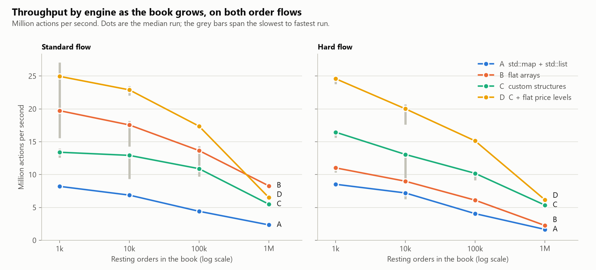
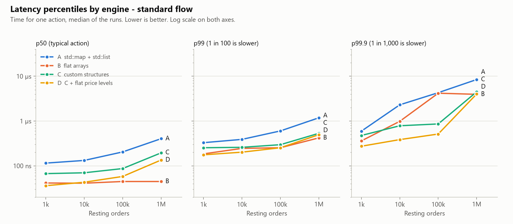
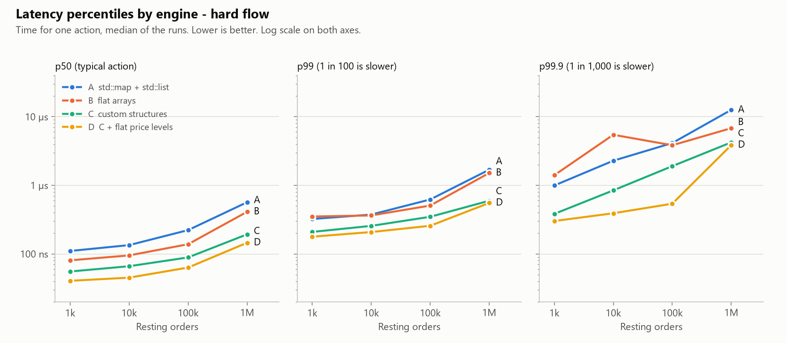
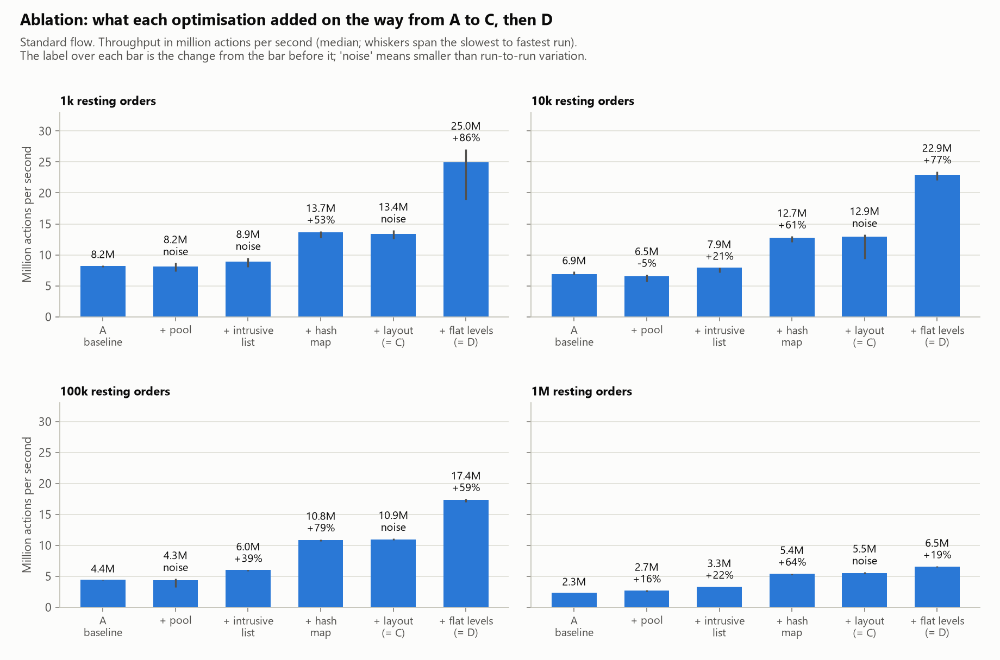
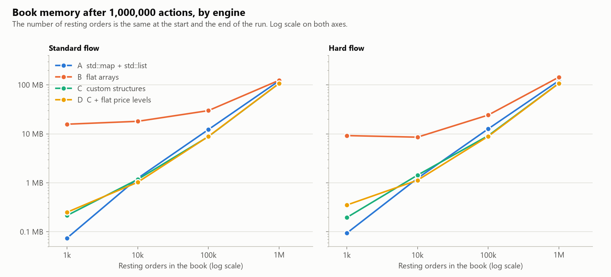

# Limit Order Book & Matching Engine

**[Read the full report (PDF)](report.pdf)**

A limit-order matching engine in C++17, implemented four times with different data structures
behind one interface, and benchmarked to answer one question:

**How does data-structure choice affect the latency and throughput of a limit-order matching engine?**

It supports limit and market orders, cancel, modify (cancel + replace), partial fills, price-time
priority, best bid/ask and spread, market depth, and a timestamped trade history. Prices are integer
cents. Python is used only to run the benchmarks and draw the charts.

## The four engines

All four derive from `OrderBookBase`, pass the same tests, and produce identical trades.

| Engine | Price levels | Queue at each price | Order-id index |
|---|---|---|---|
| **A** – baseline | `std::map` | `std::list` | `std::unordered_map` |
| **B** – flat arrays | `std::vector` indexed by price | `std::vector`, cancelled slots removed in batches | `std::deque` indexed by the id (hash-map fallback for large ids) |
| **C** – custom | `std::map` (pool-allocated) | intrusive doubly-linked list in a pre-allocated node pool, 32-byte nodes | open-addressing hash map |
| **D** – C with flat levels | array indexed by price, as in B | as C | as C |

Four intermediate versions (C1–C4) add C's changes to A one at a time, for the ablation below.

## Build and run

Requires CMake 3.15+ and a C++17 compiler.

**Windows** (tested with WinLibs MinGW-w64 GCC 16.2; `g++` and `cmake` on PATH):

```
cmake -S . -B build -G "MinGW Makefiles"
cmake --build build
.\build\tests.exe
.\build\demo.exe
```

**Linux** (GCC 9+ or Clang with a C++17 standard library that has `<memory_resource>`):

```
cmake -S . -B build
cmake --build build
./build/tests
./build/demo
```

The engines, tests and demo are standard C++17. They have only been built and run on Windows so far.
The benchmark is Windows-only (it uses the Windows API to measure memory) and CMake skips it elsewhere.

### Benchmark (Windows)

```
pip install matplotlib
python analysis\run_bench.py       # 220 runs, about 20 minutes; rewrites results\*.csv
python analysis\plot_results.py    # prints the tables, writes results\*.png
```

A single run: `.\build\bench.exe <engine> [bookSize] [actions] [run] [outDir] [standard|hard]`,
where `<engine>` is one of `A B C1 C2 C3 C4 D`.

## Project structure

```
Order.hpp               Order, Trade, Side, OrderType
OrderBookBase.hpp/.cpp  interface for every engine + rules shared by all (validation, timestamps, trade history, modify)
OrderBook.hpp/.cpp      engine A, and C1 (A + memory pool)
FlatBook.hpp/.cpp       engine B
IntrusiveBook.hpp       engines C2, C3, C (= C4) and D: one template with pluggable index, pool and price levels
Engines.hpp/.cpp        makeBook("A" | "B" | "C1" | "C2" | "C3" | "C4" | "D")
OrderFlow.hpp/.cpp      seeded order-flow generator (standard and hard flows)
tests.cpp               40 tests run against every engine + a differential test
bench.cpp               benchmark executable (-O3)
main.cpp                small demo
analysis/               run_bench.py, plot_results.py
results/                benchmark CSVs and charts
results_phase3/         earlier baseline-only results
```

## Tests

`tests` runs the same 40 assert-based tests against each of the 7 engine variants. A differential test
then replays six seeded order flows through every engine and checks that each produces the same trades
and the same final book as engine A.

## Benchmark method

- **Machine:** Intel Core i7-14650HX, Windows 11, GCC 16.2, `-O3 -DNDEBUG`, single thread pinned to one core.
- **Workload:** the book is filled to N resting orders (1k, 10k, 100k, 1M), then 1,000,000 generated
  actions are replayed: about 48% limit orders, 5% market orders, 37% cancels, 10% modifies. The generator
  keeps the book at N. The same seed gives the same actions for every engine.
- **Standard flow:** sequential order ids, prices within $2 of the mid (300–400 price levels in use).
- **Hard flow:** random 64-bit order ids, prices up to $50 from the mid (up to about 10,000 levels in
  use), 95% of passive orders within 20 cents of the mid.
- **Runs:** each measurement is a fresh process with 2 warm-up replays and 1 measured run; 5 runs per
  engine per size, with the engines interleaved.
- **Throughput** is timed over the whole replay. **Latency** is timed per action with the CPU cycle
  counter in a separate replay.
- **Noise rule:** two results are treated as different only if their run ranges (slowest to fastest
  run) do not overlap.

## Results

Median of 5 runs. Throughput is in million actions per second, with the slowest–fastest run in brackets.

### Throughput – standard flow

| Resting orders | A | B | C | D |
|---|---|---|---|---|
| 1k | 8.21 (8.06–8.33) | 19.73 (15.55–20.57) | 13.41 (12.57–13.98) | 24.96 (18.90–27.08) |
| 10k | 6.88 (6.82–7.33) | 17.56 (14.26–18.16) | 12.93 (9.36–13.26) | 22.90 (22.03–23.50) |
| 100k | 4.42 (4.33–4.47) | 13.66 (9.73–14.32) | 10.90 (10.86–11.07) | 17.37 (16.97–17.49) |
| 1M | 2.35 (2.32–2.37) | 8.29 (8.22–8.42) | 5.50 (5.44–5.66) | 6.51 (6.44–6.63) |

### Throughput – hard flow

| Resting orders | A | B | C | D |
|---|---|---|---|---|
| 1k | 8.53 (8.45–8.61) | 11.03 (10.31–11.33) | 16.46 (15.64–16.70) | 24.60 (23.78–24.64) |
| 10k | 7.21 (6.25–7.51) | 9.00 (8.90–9.14) | 13.07 (8.92–13.30) | 20.02 (17.60–20.70) |
| 100k | 4.06 (3.93–4.28) | 6.11 (5.76–6.47) | 10.20 (9.16–10.57) | 15.14 (14.84–15.61) |
| 1M | 1.66 (1.59–1.72) | 2.26 (2.17–2.28) | 5.36 (5.29–5.45) | 6.17 (5.61–6.33) |



### Latency per action (p50 / p99 / p99.9, nanoseconds)

Standard flow:

| Resting orders | A | B | C | D |
|---|---|---|---|---|
| 1k | 115 / 329 / 593 | 41 / 185 / 360 | 67 / 253 / 475 | 36 / 176 / 274 |
| 10k | 132 / 389 / 2301 | 41 / 245 / 985 | 70 / 259 / 785 | 43 / 202 / 385 |
| 100k | 204 / 601 / 4295 | 45 / 253 / 4181 | 87 / 296 / 861 | 58 / 253 / 513 |
| 1M | 403 / 1182 / 8448 | 45 / 421 / 3947 | 195 / 532 / 4487 | 135 / 496 / 4019 |

Hard flow:

| Resting orders | A | B | C | D |
|---|---|---|---|---|
| 1k | 110 / 323 / 995 | 81 / 351 / 1405 | 55 / 209 / 383 | 41 / 178 / 302 |
| 10k | 134 / 375 / 2285 | 95 / 364 / 5461 | 66 / 256 / 844 | 45 / 208 / 391 |
| 100k | 222 / 622 / 4137 | 138 / 507 / 3841 | 89 / 348 / 1904 | 63 / 257 / 539 |
| 1M | 567 / 1690 / 12612 | 411 / 1514 / 6816 | 193 / 596 / 4232 | 146 / 553 / 3864 |

Each timing includes about 6 ns of measurement overhead.





### Ablation – standard flow

Throughput after adding each change to the one before. The bracket is the change from the previous
step; "noise" means the run ranges overlap.

| Resting orders | A | + pool | + intrusive list | + hash map | + layout (= C) | + flat levels (= D) |
|---|---|---|---|---|---|---|
| 1k | 8.21 | 8.15 (noise) | 8.92 (noise) | 13.68 (+53%) | 13.41 (noise) | 24.96 (+86%) |
| 10k | 6.88 | 6.53 (−5%) | 7.92 (+21%) | 12.72 (+61%) | 12.93 (noise) | 22.90 (+77%) |
| 100k | 4.42 | 4.34 (noise) | 6.04 (+39%) | 10.82 (+79%) | 10.90 (noise) | 17.37 (+59%) |
| 1M | 2.35 | 2.71 (+16%) | 3.30 (+22%) | 5.41 (+64%) | 5.50 (noise) | 6.51 (+19%) |



### Book memory

MB used by the book right after filling it → after 1,000,000 more actions (the number of resting
orders is the same at both points). Measured as process growth through the Windows API; values for
the 1k book are approximate.

| Resting orders | Flow | A | B | C | D |
|---|---|---|---|---|---|
| 1k | standard | 0.15 → 0.07 | 0.27 → 15.74 | 0.24 → 0.21 | 0.25 → 0.25 |
| 10k | standard | 1.24 → 1.23 | 1.02 → 18.02 | 0.99 → 1.17 | 1.01 → 1.03 |
| 100k | standard | 12.21 → 12.23 | 8.85 → 29.82 | 8.59 → 8.80 | 8.62 → 8.84 |
| 1M | standard | 122.21 → 121.04 | 89.56 → 124.18 | 107.18 → 107.19 | 107.23 → 107.24 |
| 1k | hard | 0.14 → 0.09 | 1.33 → 9.22 | 0.22 → 0.20 | 0.36 → 0.35 |
| 10k | hard | 1.23 → 1.23 | 2.26 → 8.55 | 1.03 → 1.43 | 1.10 → 1.13 |
| 100k | hard | 12.44 → 12.64 | 13.94 → 24.19 | 8.94 → 9.18 | 8.61 → 8.89 |
| 1M | hard | 123.36 → 121.81 | 120.92 → 144.06 | 108.25 → 108.11 | 107.33 → 107.51 |



More output is in `results/`: the per-run CSVs, latency by action type, and latency distribution charts
at 1M orders for both flows. `python analysis\plot_results.py` reprints every table.
